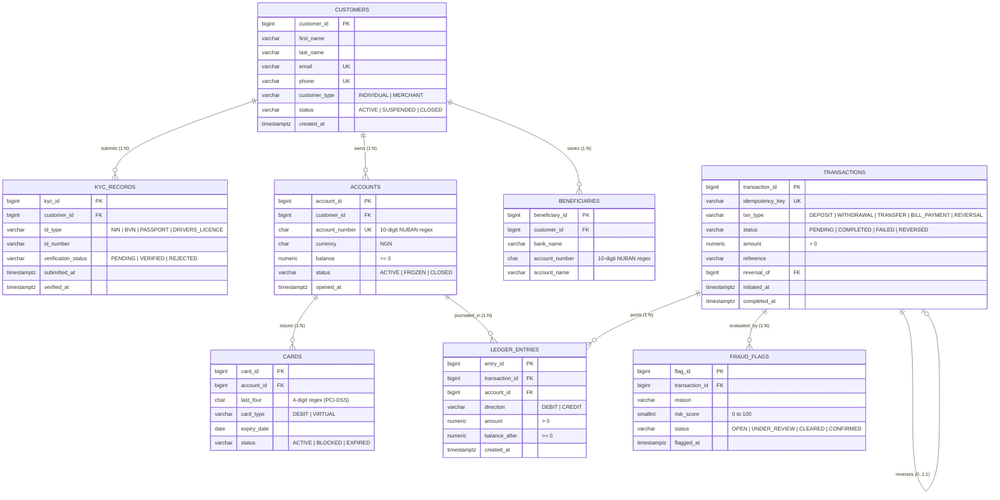

# MIT8103 Advanced Database Systems
## Portfolio 1: Relational Database Design, Implementation & Integrity Validation
### Case Study: EquityPay Financial Services Ltd.

---

## 1. Executive Summary & Overview

**Portfolio 1** presents the end-to-end design, implementation, and rigorous validation of an enterprise-grade relational database for **EquityPay Financial Services Ltd.**—a simulated next-generation neo-banking and payments institution operating under the regulatory oversight of the Central Bank of Nigeria (CBN), Nigeria Uniform Bank Account Standards (NUBAN), and Payment Card Industry Data Security Standards (PCI-DSS).

The database architecture is engineered for high-concurrency Online Transaction Processing (OLTP), guaranteeing strict **ACID** properties, mathematical financial consistency, tamper-evident audit trails, and automated defense against data corruption.

```
+---------------------------------------------------------------------------------------------------+
|                                      PORTFOLIO 1 ARCHITECTURE                                     |
+---------------------------------------------------------------------------------------------------+
|  [00_create_database.sql]       Database cluster initialization                                   |
|  [01_verify_setup.sql]          PostgreSQL environment & version verification                     |
|  [02_create_tables.sql]         DDL schema with 8 core tables, check constraints & FK boundaries  |
|  [03_constraint_tests.sql]      12 positive & negative constraint validation test scenarios       |
|  [04_seed_data.sql]             Deterministic synthetic seed generator (~400k+ ledger lines)      |
|  [05_verify_seed.sql]           Double-entry mathematical reconciliation & ledger audit suite     |
+---------------------------------------------------------------------------------------------------+
```

---

## 2. Repository Structure & Artifact Index

All deliverables for Portfolio 1 are modularized, self-contained, and reproducible:

| File | Type | Description |
| :--- | :--- | :--- |
| [00_create_database.sql](file:///c:/Users/cazuh/OneDrive%20-%20EQUINIX/Documents/MIT8103--Advanced-Database-Test/portfolio-1-database-design/00_create_database.sql) | SQL DDL | Creates the target database (`equity_db`). |
| [01_verify_setup.sql](file:///c:/Users/cazuh/OneDrive%20-%20EQUINIX/Documents/MIT8103--Advanced-Database-Test/portfolio-1-database-design/01_verify_setup.sql) | SQL Query | Verifies database connection, PostgreSQL version, and active catalog. |
| [02_create_tables.sql](file:///c:/Users/cazuh/OneDrive%20-%20EQUINIX/Documents/MIT8103--Advanced-Database-Test/portfolio-1-database-design/02_create_tables.sql) | SQL DDL | Core relational schema defining all 8 tables, constraints, foreign keys, and defaults. |
| [03_constraint_tests.sql](file:///c:/Users/cazuh/OneDrive%20-%20EQUINIX/Documents/MIT8103--Advanced-Database-Test/portfolio-1-database-design/03_constraint_tests.sql) | SQL Script | Comprehensive test suite proving active enforcement of 12 schema invariants. |
| [04_seed_data.sql](file:///c:/Users/cazuh/OneDrive%20-%20EQUINIX/Documents/MIT8103--Advanced-Database-Test/portfolio-1-database-design/04_seed_data.sql) | SQL DML | High-scale reproducible seed script (~5k customers, 6k accounts, ~206k transactions, ~406k ledger entries). |
| [05_verify_seed.sql](file:///c:/Users/cazuh/OneDrive%20-%20EQUINIX/Documents/MIT8103--Advanced-Database-Test/portfolio-1-database-design/05_verify_seed.sql) | SQL Audit | 7-part validation query suite confirming double-entry balance invariants and zero discrepancies. |
| [case-study.md](file:///c:/Users/cazuh/OneDrive%20-%20EQUINIX/Documents/MIT8103--Advanced-Database-Test/portfolio-1-database-design/case-study.md) | Technical Spec | Business background, regulatory mandates, operational actors, and use case boundaries. |
| [database-design.md](file:///c:/Users/cazuh/OneDrive%20-%20EQUINIX/Documents/MIT8103--Advanced-Database-Test/portfolio-1-database-design/database-design.md) | Architecture Spec | Complete ERD, data dictionary, double-entry mechanics, referential cascading matrix, and traceability. |
| [normalisation.md](file:///c:/Users/cazuh/OneDrive%20-%20EQUINIX/Documents/MIT8103--Advanced-Database-Test/portfolio-1-database-design/normalisation.md) | Academic Report | Normalisation walkthrough (1NF $\to$ 2NF $\to$ 3NF/BCNF) and technical defense of 4 strategic 3NF denormalisations. |
| [equitypay.dbml](file:///c:/Users/cazuh/OneDrive%20-%20EQUINIX/Documents/MIT8103--Advanced-Database-Test/portfolio-1-database-design/equitypay.dbml) | DBML Schema | Database Markup Language specification for rendering interactive ERDs (dbdocs.io, dbdiagram.io). |
| [Screenshots/](file:///c:/Users/cazuh/OneDrive%20-%20EQUINIX/Documents/MIT8103--Advanced-Database-Test/portfolio-1-database-design/Screenshots) | Visual Proof | Execution screenshots verifying pgAdmin query tool results, table creation, constraint catches, and seed audits. |

---

## 3. Entity-Relationship Model (ERD)

The database schema comprises **8 core relational entities** designed to model retail digital wallets, merchant payment gateways, regulatory compliance workflows, and double-entry financial journals.



---

## 4. Key Architectural & Engineering Decisions

### 4.1. Immutable Double-Entry Ledger System
In banking software, destructive updates to monetary balances (`UPDATE accounts SET balance = balance - 100`) introduce audit vulnerabilities, race conditions, and unjournaled money movement. EquityPay implements an append-only double-entry bookkeeping journal ([ledger_entries](file:///c:/Users/cazuh/OneDrive%20-%20EQUINIX/Documents/MIT8103--Advanced-Database-Test/portfolio-1-database-design/02_create_tables.sql#L121-L133)):
- Every financial event generates matching postings: at least one `DEBIT` and one `CREDIT`.
- For peer-to-peer transfers: Sender is debited; Receiver is credited.
- Direction uniqueness is enforced via composite unique constraint: `UNIQUE (transaction_id, account_id, direction)`.
- Running balances (`balance_after`) are stamped point-in-time and constrained by `CHECK (balance_after >= 0)`.

### 4.2. Mathematical Balance Invariant
The cached balance on `accounts.balance` must mathematically mirror the algebraic sum of historical ledger postings:

$$\text{Account Balance} = \sum_{\substack{e \in \text{ledger\_entries} \\ e.\text{account\_id} = A \\ e.\text{direction} = \text{'CREDIT'}}} e.\text{amount} \; - \sum_{\substack{e \in \text{ledger\_entries} \\ e.\text{account\_id} = A \\ e.\text{direction} = \text{'DEBIT'}}} e.\text{amount}$$

Validated via [05_verify_seed.sql](file:///c:/Users/cazuh/OneDrive%20-%20EQUINIX/Documents/MIT8103--Advanced-Database-Test/portfolio-1-database-design/05_verify_seed.sql#L33-L45) with **0 mismatches across all 6,001 accounts**.

### 4.3. Fixed-Point Arbitrary Precision Arithmetic
Floating-point data types (`FLOAT`, `REAL`, `DOUBLE PRECISION`) use binary approximations that cause cumulative penny-rounding errors. All monetary columns (`balance`, `amount`, `balance_after`) strictly use `NUMERIC(19, 4)`, supporting transactions up to $999,999,999,999,999.9999$ NGN with sub-kobo precision.

### 4.4. Network Idempotency Defense
Network fluctuations and mobile retries frequently submit identical payment requests twice. The schema enforces `idempotency_key VARCHAR(64) NOT NULL UNIQUE` on `transactions`, ensuring that duplicate submissions are rejected at the database engine level before duplicate debits can occur.

### 4.5. Transaction Reversal Mechanics & Non-Repudiation
Financial history is immutable—erroneous or disputed transactions are never deleted or modified. Instead, compensating `REVERSAL` transactions are issued, linked to the original via `reversal_of`. The schema enforces this biconditional relationship with an exact check constraint:
```sql
CHECK ((txn_type = 'REVERSAL') = (reversal_of IS NOT NULL))
```
- If `txn_type = 'REVERSAL'`, `reversal_of` must point to an existing `transaction_id`.
- If `txn_type <> 'REVERSAL'`, `reversal_of` must be `NULL`.

### 4.6. Defensive Foreign Key Strategy
Referential cascading is configured strictly according to legal and regulatory audit retention rules:
- **`ON DELETE RESTRICT`**: Applied to `customers -> accounts`, `customers -> kyc_records`, `accounts -> cards`, `accounts -> ledger_entries`, and `transactions -> ledger_entries`. Deleting an active customer or account with historical transactions is physically blocked.
- **`ON DELETE CASCADE`**: Applied solely to `customers -> beneficiaries`. Saved payee contacts represent non-financial convenience bookmarks safe to prune upon customer account closure.

### 4.7. PCI-DSS Compliance & Data Minimization
Under PCI-DSS Requirement 3, full Primary Account Numbers (PAN), CVVs, and PINs must never be stored in plaintext. The `cards` table stores only `last_four CHAR(4) CHECK (last_four ~ '^[0-9]{4}$')` and `expiry_date DATE`, minimizing breach impact.

---

## 5. Normalisation & Controlled Denormalisation Summary

The database was modeled through **Third Normal Form (3NF)** and **Boyce-Codd Normal Form (BCNF)** to eliminate redundancy and update anomalies. However, four controlled, deliberate departures from 3NF were engineered for critical operational efficiency:

| Denormalised Column | Normal Form Violation | Rationale & Performance Impact | Safeguard / Invariant |
| :--- | :--- | :--- | :--- |
| **`accounts.balance`** | Transitive dependency on child `ledger_entries` (3NF violation) | Avoids summing hundreds of thousands of historical ledger rows for simple balance checks / POS checkouts. Converts an $O(N)$ table scan into an instantaneous $O(1)$ index lookup. | Synchronized atomically within payment transactions; audited by reconciliation scripts. |
| **`ledger_entries.balance_after`** | Redundant historical state (3NF violation) | Provides an immutable snapshot of account balance immediately after journal posting. Enables instant point-in-time statement generation without window calculations. | Enforced via `CHECK (balance_after >= 0)` to prevent transient overdrafts. |
| **`transactions.amount`** | Redundant with `ledger_entries.amount` (3NF violation) | Allows external payment switches, webhooks, and push notification workers to inspect transaction volume without joining the ledger. | Validated in application service logic to match double-entry ledger lines. |
| **`beneficiaries.account_name`** | Transitive dependency on external NIBSS registry | Caches the verified account name at the time the payee was added. Eliminates external API latency on recurring P2P transfers. | Isolated from internal customer identities; bound to customer profile. |

*For formal functional dependency proofs and anomaly analyses, see [normalisation.md](file:///c:/Users/cazuh/OneDrive%20-%20EQUINIX/Documents/MIT8103--Advanced-Database-Test/portfolio-1-database-design/normalisation.md).*

---

## 6. Step-by-Step Execution Guide

### Prerequisites
- **PostgreSQL**: Version 14 or higher (developed and verified on PostgreSQL 18.6).
- **Client**: pgAdmin 4 (Query Tool) or CLI `psql`.

---

### Step 1: Database Initialization
Open pgAdmin Query Tool connected to the default `postgres` database and run [00_create_database.sql](file:///c:/Users/cazuh/OneDrive%20-%20EQUINIX/Documents/MIT8103--Advanced-Database-Test/portfolio-1-database-design/00_create_database.sql):
```sql
CREATE DATABASE equity_db;
```

Switch connection to `equity_db` and verify the environment using [01_verify_setup.sql](file:///c:/Users/cazuh/OneDrive%20-%20EQUINIX/Documents/MIT8103--Advanced-Database-Test/portfolio-1-database-design/01_verify_setup.sql):
```sql
SELECT version(), current_database();
```

---

### Step 2: Schema Creation (DDL)
Execute [02_create_tables.sql](file:///c:/Users/cazuh/OneDrive%20-%20EQUINIX/Documents/MIT8103--Advanced-Database-Test/portfolio-1-database-design/02_create_tables.sql) to create all 8 core tables inside a single atomic transaction block (`BEGIN; ... COMMIT;`).

**Expected Outcome**: 8 tables created with all check constraints, primary keys, identity sequences, and foreign keys established.

---

### Step 3: Constraint & Integrity Testing
Execute [03_constraint_tests.sql](file:///c:/Users/cazuh/OneDrive%20-%20EQUINIX/Documents/MIT8103--Advanced-Database-Test/portfolio-1-database-design/03_constraint_tests.sql). 

> [!IMPORTANT]
> Because [03_constraint_tests.sql](file:///c:/Users/cazuh/OneDrive%20-%20EQUINIX/Documents/MIT8103--Advanced-Database-Test/portfolio-1-database-design/03_constraint_tests.sql) contains **intentional negative test cases**, highlight and execute the tests individually (or use `ROLLBACK;` between runs) to observe PostgreSQL actively rejecting invalid data:

1. **Unique email violation** (`customers_email_key`)
2. **Invalid customer type check** (`customers_customer_type_check`)
3. **Negative account balance check** (`accounts_balance_check`)
4. **Invalid 10-digit NUBAN format regex** (`accounts_account_number_check`)
5. **Foreign key lookup violation** (`accounts_customer_id_fkey`)
6. **Zero transaction amount check** (`transactions_amount_check`)
7. **Invalid reversal constraint violation** (`transactions_check`)
8. **Duplicate idempotency key unique constraint** (`transactions_idempotency_key_key`)
9. **Invalid ledger direction check** (`ledger_entries_direction_check`)
10. **Duplicate transaction-account-direction composite constraint** (`ledger_entries_transaction_id_account_id_direction_key`)
11. **`ON DELETE RESTRICT` protection on customer deletion** (`accounts_customer_id_fkey`)
12. **Pending KYC verification time constraint violation** (`kyc_records_check`)
13. **`ON DELETE CASCADE` test on beneficiaries** (verifies automatic cascade cleanup)

---

### Step 4: Synthetic Seed Generation
Execute [04_seed_data.sql](file:///c:/Users/cazuh/OneDrive%20-%20EQUINIX/Documents/MIT8103--Advanced-Database-Test/portfolio-1-database-design/04_seed_data.sql) in pgAdmin (press **F5**).

The script runs entirely within an isolated transaction (`BEGIN; ... COMMIT;`), calls `setseed(0.42)` for deterministic repeatability, and executes in ~10–25 seconds.

---

### Step 5: Post-Seed Verification & Audit
Execute [05_verify_seed.sql](file:///c:/Users/cazuh/OneDrive%20-%20EQUINIX/Documents/MIT8103--Advanced-Database-Test/portfolio-1-database-design/05_verify_seed.sql) to run the comprehensive 7-point audit suite.

---

## 7. Verification Results & Validation Audit

Running [05_verify_seed.sql](file:///c:/Users/cazuh/OneDrive%20-%20EQUINIX/Documents/MIT8103--Advanced-Database-Test/portfolio-1-database-design/05_verify_seed.sql) produces the following verified audit results:

### 7.1. Master Table Row Counts
```
   table_name   | row_count 
----------------+-----------
 accounts       |      6001
 beneficiaries  |     15000
 cards          |      2465
 customers      |      5001
 fraud_flags    |       512
 kyc_records    |      5125
 ledger_entries |    406200
 transactions   |    206100
(8 rows)
```

### 7.2. Transactions Distribution by Type & Status
```
   txn_type   |  status   | txn_count 
--------------+-----------+-----------
 DEPOSIT      | COMPLETED |      6000
 REVERSAL     | COMPLETED |       100
 TRANSFER     | COMPLETED |    195904
 TRANSFER     | FAILED    |      3996
 TRANSFER     | REVERSED  |       100
(5 rows)
```

### 7.3. Mathematical Double-Entry Reconciliation Audit
```sql
-- Query 3: Double-entry check: every transaction with ledger lines must balance
SELECT count(*) AS unbalanced_transactions FROM (...);
-- RESULT: 0 (PASSED)

-- Query 4: Cached balance check: accounts.balance must equal ledger total
SELECT count(*) AS mismatched_accounts FROM (...);
-- RESULT: 0 (PASSED)

-- Query 5: Completed or reversed transactions with no ledger lines
SELECT count(*) AS completed_without_ledger FROM (...);
-- RESULT: 0 (PASSED)

-- Query 6: Failed transactions must have no ledger lines
SELECT count(*) AS failed_with_ledger FROM (...);
-- RESULT: 0 (PASSED)
```

---

## 8. Visual Evidence & Execution Screenshots

All database setup, schema creation, constraint testing, and seed verification steps have been executed and captured from pgAdmin 4 in the [Screenshots/](file:///c:/Users/cazuh/OneDrive%20-%20EQUINIX/Documents/MIT8103--Advanced-Database-Test/portfolio-1-database-design/Screenshots) directory:

| Step / Milestone | Screenshot File | Description |
| :--- | :--- | :--- |
| **Setup & Connection** | [01-setup.png](Screenshots/01-setup.png) | PostgreSQL 18.6 connection and `equity_db` verification. |
| **Table Creation DDL** | [02-tables-created.png](Screenshots/02-tables-created.png) | Execution of [02_create_tables.sql](file:///c:/Users/cazuh/OneDrive%20-%20EQUINIX/Documents/MIT8103--Advanced-Database-Test/portfolio-1-database-design/02_create_tables.sql) showing successful DDL commit. |
| **Constraint Testing** | [03-constraint-tests.png](Screenshots/03-constraint-tests.png) | Active constraint violation catches (negative testing). |
| **Schema Tree** | [04-equity-pay-db_table.png](Screenshots/04-equity-pay-db_table.png) | pgAdmin object browser showing all 8 tables and indexes. |
| **Setup Verification** | [05-equity-pay-db_verify.png](Screenshots/05-equity-pay-db_verify.png) | Table existence and initial schema checks. |
| **Seed Data Execution** | [06-equity-pay-db_seeddata.png](Screenshots/06-equity-pay-db_seeddata.png) | Successful completion of [04_seed_data.sql](file:///c:/Users/cazuh/OneDrive%20-%20EQUINIX/Documents/MIT8103--Advanced-Database-Test/portfolio-1-database-design/04_seed_data.sql) transaction. |
| **Seed Verification Audit** | [equity-pay-db_verifyseed.png](Screenshots/equity-pay-db_verifyseed.png) | Execution of [05_verify_seed.sql](file:///c:/Users/cazuh/OneDrive%20-%20EQUINIX/Documents/MIT8103--Advanced-Database-Test/portfolio-1-database-design/05_verify_seed.sql) confirming 0 discrepancies. |
| **ER Diagram** | [er-diagram.png](Screenshots/er-diagram.png) | High-resolution visual entity-relationship diagram. |

---

## 9. Alignment with Subsequent Portfolios

The schema and dataset created in Portfolio 1 serve as the concrete foundation for the remainder of the MIT8103 Advanced Database Systems curriculum:

- **Portfolio 2 (Query Optimisation & Indexing)**: Evaluates query execution plans (`EXPLAIN ANALYZE`), index scan strategies (B-Tree, composite, partial), and query tuning against the 200,000+ transaction ledger.
- **Portfolio 3 (Transactions & Concurrency Control)**: Leverages `accounts`, `transactions`, and `ledger_entries` to test transaction isolation levels (`READ COMMITTED`, `REPEATABLE READ`, `SERIALIZABLE`), row-level pessimistic locking (`SELECT ... FOR UPDATE`), and deadlock resolution under concurrent transfer loads.
- **Portfolio 4 (NoSQL Integration)**: Explores polyglot persistence (e.g., caching hot wallet balances or routing fraud detection telemetry to document / key-value stores).
- **Portfolio 5 (Distributed & Cloud Databases)**: Evaluates read replica distribution, horizontal sharding by customer geographic region, and high-availability failover architectures.
