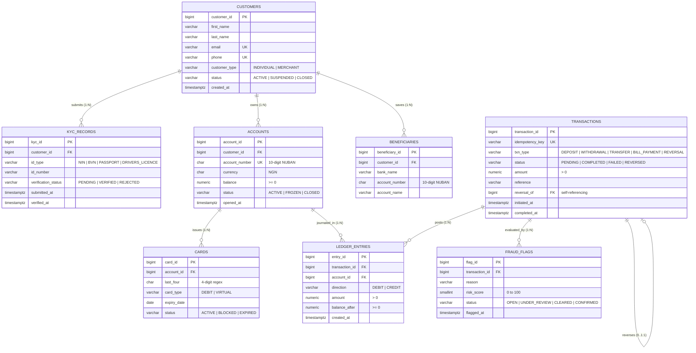

# EquityPay Database Design Documentation

## 1. Executive Summary & Architectural Overview

The **EquityPay Financial Banking System** database is engineered as an enterprise-grade, high-concurrency, Online Transaction Processing (OLTP) relational data platform. Designed for the Nigerian fintech ecosystem, the architecture satisfies strict regulatory standards (e.g., Central Bank of Nigeria [CBN] compliance, NUBAN account structure, PCI-DSS compliance, and Anti-Money Laundering [AML] requirements).

### Core Architectural Pillars
1. **Immutable Double-Entry Bookkeeping**: Monetary transactions are never modeled as simple destructive balance overwrites. Every business transaction creates balanced ledger postings (`DEBIT` and `CREDIT`) in an append-only journal (`ledger_entries`), guaranteeing mathematical consistency and full auditability.
2. **Fixed-Point High Precision Financial Arithmetic**: Currency values are strictly stored as `NUMERIC(19, 4)` to eliminate floating-point rounding errors and precision leakage inherent in binary floating-point types (`FLOAT` or `DOUBLE PRECISION`).
3. **Idempotency by Design**: Every transaction incorporates an `idempotency_key` unique constraint, preventing double-debiting or duplicated transaction posting caused by mobile client retries or network latency.
4. **Defensive Referential Integrity**: A deliberate cascading strategy enforces `ON DELETE RESTRICT` on historical, financial, and compliance entities to prevent accidental or malicious deletion of audit trails, while allowing `ON DELETE CASCADE` only on auxiliary, non-ledger user data (e.g., saved beneficiaries).
5. **PCI-DSS Data Minimization**: Card data is minimized at rest. Only the `last_four` digits, card type, and expiry date are preserved; full Primary Account Numbers (PAN), CVVs, and PINs are strictly excluded.

---

## 2. Entity-Relationship Model (ERD)

The conceptual and logical data model comprises 8 core entities organized around customer identity, account management, transactional orchestration, double-entry ledgering, and fraud mitigation.



---

## 3. Data Dictionary & Detailed Schema Specifications

### 3.1. `customers` Table
Represents master identity profiles for individuals and commercial merchants registered on EquityPay.

| Column Name | Data Type | Constraints | Default | Description |
| :--- | :--- | :--- | :--- | :--- |
| `customer_id` | `BIGINT` | `GENERATED ALWAYS AS IDENTITY`, `PRIMARY KEY` | Sequence | System surrogate primary key. |
| `first_name` | `VARCHAR(100)` | `NOT NULL` | — | Legal first name or registered business contact. |
| `last_name` | `VARCHAR(100)` | `NOT NULL` | — | Legal surname or corporate business name. |
| `email` | `VARCHAR(255)` | `NOT NULL`, `UNIQUE` | — | Primary email address for authentication and alerts. |
| `phone` | `VARCHAR(20)` | `NOT NULL`, `UNIQUE` | — | International/E.164 compliant phone number. |
| `customer_type`| `VARCHAR(20)` | `NOT NULL`, `CHECK (customer_type IN ('INDIVIDUAL', 'MERCHANT'))` | — | Account tier classification. |
| `status` | `VARCHAR(20)` | `NOT NULL`, `CHECK (status IN ('ACTIVE', 'SUSPENDED', 'CLOSED'))` | `'ACTIVE'` | Current operational status of customer profile. |
| `created_at` | `TIMESTAMPTZ` | `NOT NULL` | `now()` | Immutable registration timestamp with timezone. |

---

### 3.2. `kyc_records` Table
Tracks Know-Your-Customer identity submissions, supporting multi-tier verification and re-submissions.

| Column Name | Data Type | Constraints | Default | Description |
| :--- | :--- | :--- | :--- | :--- |
| `kyc_id` | `BIGINT` | `GENERATED ALWAYS AS IDENTITY`, `PRIMARY KEY` | Sequence | Surrogate key for verification record. |
| `customer_id` | `BIGINT` | `NOT NULL`, `REFERENCES customers(customer_id) ON DELETE RESTRICT` | — | Foreign key pointing to customer. |
| `id_type` | `VARCHAR(30)` | `NOT NULL`, `CHECK (id_type IN ('NIN', 'BVN', 'PASSPORT', 'DRIVERS_LICENCE'))` | — | National regulatory identity document type. |
| `id_number` | `VARCHAR(50)` | `NOT NULL` | — | Unique identifier string from the issued credential. |
| `verification_status` | `VARCHAR(20)` | `NOT NULL`, `CHECK (verification_status IN ('PENDING', 'VERIFIED', 'REJECTED'))` | `'PENDING'` | Regulatory verification lifecycle status. |
| `submitted_at`| `TIMESTAMPTZ` | `NOT NULL` | `now()` | Timestamp of document upload. |
| `verified_at` | `TIMESTAMPTZ` | `NULLABLE` | `NULL` | Timestamp of compliance review completion. |

*Table-Level Check Constraint*:
- `CHECK (verified_at IS NULL OR verification_status <> 'PENDING')`: Guarantees a pending verification record cannot have a verification timestamp.

---

### 3.3. `accounts` Table
Maintains digital wallets and current cached balances denominated in Nigerian Naira (NGN).

| Column Name | Data Type | Constraints | Default | Description |
| :--- | :--- | :--- | :--- | :--- |
| `account_id` | `BIGINT` | `GENERATED ALWAYS AS IDENTITY`, `PRIMARY KEY` | Sequence | Surrogate primary key. |
| `customer_id` | `BIGINT` | `NOT NULL`, `REFERENCES customers(customer_id) ON DELETE RESTRICT` | — | Account owner reference. |
| `account_number` | `CHAR(10)` | `NOT NULL`, `UNIQUE`, `CHECK (account_number ~ '^[0-9]{10}$')` | — | 10-digit NUBAN account identifier. |
| `currency` | `CHAR(3)` | `NOT NULL` | `'NGN'` | ISO-4217 3-letter currency code. |
| `balance` | `NUMERIC(19,4)`| `NOT NULL`, `CHECK (balance >= 0)` | `0` | Cached running balance derived from ledger entries. |
| `status` | `VARCHAR(20)` | `NOT NULL`, `CHECK (status IN ('ACTIVE', 'FROZEN', 'CLOSED'))` | `'ACTIVE'` | Account operational and risk state. |
| `opened_at` | `TIMESTAMPTZ` | `NOT NULL` | `now()` | Account provisioning timestamp. |

---

### 3.4. `beneficiaries` Table
Maintains a customer's address book of frequent counterparty transfer recipients.

| Column Name | Data Type | Constraints | Default | Description |
| :--- | :--- | :--- | :--- | :--- |
| `beneficiary_id`| `BIGINT` | `GENERATED ALWAYS AS IDENTITY`, `PRIMARY KEY` | Sequence | Surrogate primary key. |
| `customer_id` | `BIGINT` | `NOT NULL`, `REFERENCES customers(customer_id) ON DELETE CASCADE` | — | Beneficiary list owner. |
| `bank_name` | `VARCHAR(100)`| `NOT NULL` | — | Receiving financial institution name. |
| `account_number`| `CHAR(10)` | `NOT NULL`, `CHECK (account_number ~ '^[0-9]{10}$')` | — | 10-digit NUBAN destination number. |
| `account_name` | `VARCHAR(150)`| `NOT NULL` | — | Verified title of destination account. |

*Table-Level Constraint*:
- `UNIQUE (customer_id, bank_name, account_number)`: Prevents duplicate payee records per customer.

---

### 3.5. `cards` Table
Maintains physical debit and virtual payment cards linked to an active account.

| Column Name | Data Type | Constraints | Default | Description |
| :--- | :--- | :--- | :--- | :--- |
| `card_id` | `BIGINT` | `GENERATED ALWAYS AS IDENTITY`, `PRIMARY KEY` | Sequence | Surrogate primary key. |
| `account_id` | `BIGINT` | `NOT NULL`, `REFERENCES accounts(account_id) ON DELETE RESTRICT` | — | Underlying account funding the card. |
| `last_four` | `CHAR(4)` | `NOT NULL`, `CHECK (last_four ~ '^[0-9]{4}$')` | — | Last 4 digits of PAN (PCI-DSS compliant). |
| `card_type` | `VARCHAR(20)` | `NOT NULL`, `CHECK (card_type IN ('DEBIT', 'VIRTUAL'))` | — | Physical debit card or virtual tokenized card. |
| `expiry_date` | `DATE` | `NOT NULL` | — | Card expiration date. |
| `status` | `VARCHAR(20)` | `NOT NULL`, `CHECK (status IN ('ACTIVE', 'BLOCKED', 'EXPIRED'))` | `'ACTIVE'` | Card lifecycle state. |

---

### 3.6. `transactions` Table
Records discrete financial transaction events, payment requests, and external payment references.

| Column Name | Data Type | Constraints | Default | Description |
| :--- | :--- | :--- | :--- | :--- |
| `transaction_id`| `BIGINT` | `GENERATED ALWAYS AS IDENTITY`, `PRIMARY KEY` | Sequence | Surrogate primary key. |
| `idempotency_key`| `VARCHAR(64)` | `NOT NULL`, `UNIQUE` | — | Unique client token preventing duplicate posting. |
| `txn_type` | `VARCHAR(20)` | `NOT NULL`, `CHECK (txn_type IN ('DEPOSIT', 'WITHDRAWAL', 'TRANSFER', 'BILL_PAYMENT', 'REVERSAL'))` | — | Classification of business transaction. |
| `status` | `VARCHAR(20)` | `NOT NULL`, `CHECK (status IN ('PENDING', 'COMPLETED', 'FAILED', 'REVERSED'))` | `'PENDING'` | Overall transaction processing status. |
| `amount` | `NUMERIC(19,4)`| `NOT NULL`, `CHECK (amount > 0)` | — | Principal transaction amount. |
| `reference` | `VARCHAR(100)`| `NULLABLE` | `NULL` | External switch/payment gateway reference. |
| `reversal_of` | `BIGINT` | `NULLABLE`, `REFERENCES transactions(transaction_id) ON DELETE RESTRICT` | `NULL` | Self-referential pointer to original transaction. |
| `initiated_at` | `TIMESTAMPTZ` | `NOT NULL` | `now()` | Timestamp when transaction was created. |
| `completed_at` | `TIMESTAMPTZ` | `NULLABLE` | `NULL` | Timestamp of terminal status transition. |

*Table-Level Check Constraint*:
- `CHECK ((txn_type = 'REVERSAL') = (reversal_of IS NOT NULL))`: Enforces exact logical equivalence: a transaction is classified as `REVERSAL` if and only if it explicitly references an existing transaction.

---

### 3.7. `ledger_entries` Table
The immutable double-entry journal lines. Every financial transaction generates balancing debits and credits across accounts.

| Column Name | Data Type | Constraints | Default | Description |
| :--- | :--- | :--- | :--- | :--- |
| `entry_id` | `BIGINT` | `GENERATED ALWAYS AS IDENTITY`, `PRIMARY KEY` | Sequence | Surrogate primary key. |
| `transaction_id`| `BIGINT` | `NOT NULL`, `REFERENCES transactions(transaction_id) ON DELETE RESTRICT` | — | Foreign key to triggering transaction event. |
| `account_id` | `BIGINT` | `NOT NULL`, `REFERENCES accounts(account_id) ON DELETE RESTRICT` | — | Affected account identifier. |
| `direction` | `VARCHAR(6)` | `NOT NULL`, `CHECK (direction IN ('DEBIT', 'CREDIT'))` | — | Accounting direction. |
| `amount` | `NUMERIC(19,4)`| `NOT NULL`, `CHECK (amount > 0)` | — | Movement amount. |
| `balance_after` | `NUMERIC(19,4)`| `NOT NULL`, `CHECK (balance_after >= 0)` | — | Exact point-in-time account balance snapshot. |
| `created_at` | `TIMESTAMPTZ` | `NOT NULL` | `now()` | Immutable timestamp of ledger posting. |

*Table-Level Constraint*:
- `UNIQUE (transaction_id, account_id, direction)`: Prevents double posting of the same direction on the same account for a single transaction.

---

### 3.8. `fraud_flags` Table
Maintains AML/fraud monitoring alerts, risk scores, and investigative audit statuses.

| Column Name | Data Type | Constraints | Default | Description |
| :--- | :--- | :--- | :--- | :--- |
| `flag_id` | `BIGINT` | `GENERATED ALWAYS AS IDENTITY`, `PRIMARY KEY` | Sequence | Surrogate primary key. |
| `transaction_id`| `BIGINT` | `NOT NULL`, `REFERENCES transactions(transaction_id) ON DELETE RESTRICT` | — | Flagged transaction reference. |
| `reason` | `VARCHAR(200)`| `NOT NULL` | — | Automated detection trigger or investigative rationale. |
| `risk_score` | `SMALLINT` | `NOT NULL`, `CHECK (risk_score BETWEEN 0 AND 100)` | — | Normalized risk severity score (0: Low, 100: Critical). |
| `status` | `VARCHAR(20)` | `NOT NULL`, `CHECK (status IN ('OPEN', 'UNDER_REVIEW', 'CLEARED', 'CONFIRMED'))` | `'OPEN'` | Compliance triage status. |
| `flagged_at` | `TIMESTAMPTZ` | `NOT NULL` | `now()` | Timestamp of flag creation. |

---

## 4. Advanced Relational Constraints & Invariants

```
+---------------------------------------------------------------------------------------------------+
|                                  DATABASE INTEGRITY DEFENSE LAYERS                                |
+---------------------------------------------------------------------------------------------------+
|  1. Data Type Domain Integrity: NUMERIC(19,4), CHAR(10), CHAR(4), SMALLINT, TIMESTAMPTZ          |
|  2. Domain Check Constraints: Regex for NUBAN/Cards, Risk score range [0-100], amount > 0        |
|  3. Uniqueness Guarantees: email, phone, account_number, idempotency_key                          |
|  4. Composite Uniqueness: (customer_id, bank_name, account_number), (txn_id, acct_id, direction)  |
|  5. Conditional Equivalence: (txn_type = 'REVERSAL') <===> (reversal_of IS NOT NULL)             |
|  6. Temporal Integrity: verified_at IS NULL OR verification_status <> 'PENDING'                   |
|  7. Referential Deletion Guards: ON DELETE RESTRICT for accounts, txns, ledgers, kyc, cards       |
+---------------------------------------------------------------------------------------------------+
```

### 4.1. Account Number & Card Formatting (Regex Constraints)
- **NUBAN Compliance**: `account_number ~ '^[0-9]{10}$'` enforces that account numbers consist of exactly 10 numeric digits, directly conforming to Central Bank of Nigeria requirements.
- **Card Security**: `last_four ~ '^[0-9]{4}$'` ensures card representations store exactly 4 digits, eliminating malformed card artifacts.

### 4.2. Mathematical Balance Invariants
- **Non-Negative Balances**: `balance >= 0` and `balance_after >= 0` guarantee that unauthorized overdrafts and negative ledger states are blocked at the engine level.
- **Strictly Positive Transfer Amounts**: Both `transactions.amount > 0` and `ledger_entries.amount > 0` prevent zero-value spamming and negative-value credit injection attacks.

### 4.3. Conditional Equivalence on Reversals
The constraint:
```sql
CHECK ((txn_type = 'REVERSAL') = (reversal_of IS NOT NULL))
```
uses PostgreSQL's boolean equality operator (`=`). It enforces:
- If `txn_type = 'REVERSAL'`, then `reversal_of` **must not** be `NULL`.
- If `txn_type <> 'REVERSAL'`, then `reversal_of` **must** be `NULL`.

This guarantees that standard transfers cannot reference random transactions, and reversals can never exist without pointing to the original transaction.

### 4.4. State-Dependent Temporal Verification
The constraint on `kyc_records`:
```sql
CHECK (verified_at IS NULL OR verification_status <> 'PENDING')
```
ensures that incomplete/pending verification requests cannot prematurely carry a timestamp, preserving the integrity of compliance audit chronologies.

---

## 5. Financial Engineering & Double-Entry Mechanics

### 5.1. Resolving the Many-to-Many Relationship
A financial transaction touches multiple accounts (e.g., a P2P transfer debits Account A and credits Account B; a bill payment debits Customer Account and credits Utility Settlement Account).

`ledger_entries` resolves this M:N relationship by transforming each transaction into a balanced set of directed journal lines:

$$\text{Transaction } (T_1) \longrightarrow \begin{cases} \text{DEBIT}: & \text{Account } A \quad (\text{Amount } X, \text{Balance After } B_A - X) \\ \text{CREDIT}: & \text{Account } B \quad (\text{Amount } X, \text{Balance After } B_B + X) \end{cases}$$

### 5.2. Mathematical Balance Invariant
At any point in time, the cached balance in `accounts.balance` must exactly equal the aggregate sum of all historical credits minus debits:

$$\text{Account Balance} = \sum_{\substack{e \in \text{ledger\_entries} \\ e.\text{account\_id} = A \\ e.\text{direction} = \text{'CREDIT'}}} e.\text{amount} \; - \sum_{\substack{e \in \text{ledger\_entries} \\ e.\text{account\_id} = A \\ e.\text{direction} = \text{'DEBIT'}}} e.\text{amount}$$

The `balance_after` column records an unalterable point-in-time snapshot, enabling instantaneous reconstruction of ledger states during internal audit reviews.

### 5.3. Immutable History & Transaction Reversals
Rather than updating or deleting historical transaction rows when a payment fails or is refunded, EquityPay issues a new transaction with `txn_type = 'REVERSAL'` that points to `reversal_of`. The reversal generates two new compensating ledger lines:
- `CREDIT` on the original sender's account.
- `DEBIT` on the original recipient's account.

This preserves full non-repudiation and chronological immutability.

---

## 6. Referential Integrity & Foreign Key Cascading Strategy

| Relationship | Parent Table | Child Table | Action | Architectural & Business Rationale |
| :--- | :--- | :--- | :--- | :--- |
| Customer $\to$ Accounts | `customers` | `accounts` | `ON DELETE RESTRICT` | Accounts hold legal financial balances. A customer record cannot be purged while financial accounts exist. |
| Customer $\to$ KYC Records | `customers` | `kyc_records` | `ON DELETE RESTRICT` | Compliance and AML regulations require historical identity verification records to be retained even during profile closure. |
| Customer $\to$ Beneficiaries | `customers` | `beneficiaries` | `ON DELETE CASCADE` | Beneficiaries represent convenience address book data with zero financial bearing; safe to cascade delete on user removal. |
| Account $\to$ Cards | `accounts` | `cards` | `ON DELETE RESTRICT` | Cards represent active payment instruments linked to funding accounts; prevents orphan cards. |
| Account $\to$ Ledger Entries | `accounts` | `ledger_entries` | `ON DELETE RESTRICT` | Financial journals are immutable; deleting an account with posted ledger history is strictly illegal. |
| Transaction $\to$ Ledger Entries | `transactions` | `ledger_entries` | `ON DELETE RESTRICT` | Guarantees ledger postings remain perpetually bound to their parent transaction event. |
| Transaction $\to$ Fraud Flags | `transactions` | `fraud_flags` | `ON DELETE RESTRICT` | AML audit flags must remain intact for external supervisory inspection (CBN / NFIU). |
| Transaction $\to$ Reversal | `transactions` | `transactions` | `ON DELETE RESTRICT` | Prevents the deletion of an original transaction if a reversal depends on it for lineage. |

---

## 7. Security, Compliance & Normalization Assessment

### 7.1. PCI-DSS Compliance
In accordance with Payment Card Industry Data Security Standards (PCI-DSS):
- The `cards` table intentionally omits the Primary Account Number (PAN), Card Verification Value (CVV/CVV2), and Cardholder PIN.
- Only the `last_four` digits and `expiry_date` are stored for identification and customer receipt rendering.

### 7.2. Anti-Money Laundering (AML) & Fraud Mitigation
- All transactions undergo automated screening, populating `fraud_flags` with a normalized `risk_score` (0–100).
- The progression from `OPEN -> UNDER_REVIEW -> CLEARED / CONFIRMED` provides end-to-end auditability of regulatory interventions.

### 7.3. Normalization Form Compliance
- **First Normal Form (1NF)**: All attributes are atomic (scalar types); no repeating groups or comma-delimited arrays exist; primary keys are defined on all tables.
- **Second Normal Form (2NF)**: All non-key attributes are fully functionally dependent on the primary keys.
- **Third Normal Form (3NF)**: Transitive dependencies are removed. Entity attributes depend solely on the primary key (e.g., customer details are normalized into `customers` rather than repeated inside `accounts` or `transactions`).
- **Boyce-Codd Normal Form (BCNF)**: Every determinant in all relations is a candidate key.

---

## 8. Summary Traceability Matrix

| Business Requirement | Schema Implementation | File Reference |
| :--- | :--- | :--- |
| Unique customer identity | `customers(email, phone)` unique constraints | [02_create_tables.sql](file:///c:/Users/cazuh/OneDrive%20-%20EQUINIX/Documents/MIT8103--Advanced-Database-Test/portfolio-1-database-design/02_create_tables.sql#L9-L20) |
| Tiered identity compliance | `kyc_records` with verification constraint | [02_create_tables.sql](file:///c:/Users/cazuh/OneDrive%20-%20EQUINIX/Documents/MIT8103--Advanced-Database-Test/portfolio-1-database-design/02_create_tables.sql#L27-L40) |
| NUBAN 10-digit accounts | `accounts.account_number` regex check | [02_create_tables.sql](file:///c:/Users/cazuh/OneDrive%20-%20EQUINIX/Documents/MIT8103--Advanced-Database-Test/portfolio-1-database-design/02_create_tables.sql#L47-L59) |
| Zero-overdraft protection | `accounts.balance >= 0` check constraint | [02_create_tables.sql](file:///c:/Users/cazuh/OneDrive%20-%20EQUINIX/Documents/MIT8103--Advanced-Database-Test/portfolio-1-database-design/02_create_tables.sql#L54-L55) |
| Payee uniqueness | `beneficiaries` composite unique constraint | [02_create_tables.sql](file:///c:/Users/cazuh/OneDrive%20-%20EQUINIX/Documents/MIT8103--Advanced-Database-Test/portfolio-1-database-design/02_create_tables.sql#L65-L75) |
| Card security minimization | `cards.last_four` regex check | [02_create_tables.sql](file:///c:/Users/cazuh/OneDrive%20-%20EQUINIX/Documents/MIT8103--Advanced-Database-Test/portfolio-1-database-design/02_create_tables.sql#L81-L90) |
| Idempotency & network retry safety | `transactions.idempotency_key` unique constraint | [02_create_tables.sql](file:///c:/Users/cazuh/OneDrive%20-%20EQUINIX/Documents/MIT8103--Advanced-Database-Test/portfolio-1-database-design/02_create_tables.sql#L98-L113) |
| Non-destructive reversals | `transactions.reversal_of` bidirectional check | [02_create_tables.sql](file:///c:/Users/cazuh/OneDrive%20-%20EQUINIX/Documents/MIT8103--Advanced-Database-Test/portfolio-1-database-design/02_create_tables.sql#L111-L112) |
| Double-entry balanced ledger | `ledger_entries` with composite direction uniqueness | [02_create_tables.sql](file:///c:/Users/cazuh/OneDrive%20-%20EQUINIX/Documents/MIT8103--Advanced-Database-Test/portfolio-1-database-design/02_create_tables.sql#L121-L133) |
| Automated AML risk triage | `fraud_flags` with bounded `risk_score` check | [02_create_tables.sql](file:///c:/Users/cazuh/OneDrive%20-%20EQUINIX/Documents/MIT8103--Advanced-Database-Test/portfolio-1-database-design/02_create_tables.sql#L139-L148) |
