# Database Normalisation and Controlled Denormalisation Analysis

## 1. Executive Summary & Normalisation Principles

In relational database design, **Normalisation** is the formal mathematical process of decomposing relations to eliminate data redundancy, avoid update, insertion, and deletion anomalies, and enforce functional dependency integrity. 

For enterprise Online Transaction Processing (OLTP) systems, standard database theory mandates compliance with **Third Normal Form (3NF)** and **Boyce-Codd Normal Form (BCNF)**:
- **First Normal Form (1NF)**: Every attribute contains only atomic (indivisible) values; there are no repeating groups or multi-valued arrays; each table has a designated primary key.
- **Second Normal Form (2NF)**: The relation is in 1NF and every non-prime attribute is fully functionally dependent on the entire primary key (no partial key dependencies).
- **Third Normal Form (3NF)**: The relation is in 2NF and no non-prime attribute is transitively dependent on the primary key ($X \to Y$, where $Y$ is not a candidate key and $X$ is not a superkey). In practical terms: **"Every non-key attribute must provide a fact about the key, the whole key, and nothing but the key."**

While the EquityPay relational schema strictly adheres to 1NF, 2NF, and BCNF across master entities, **it deliberately and strategically breaks Third Normal Form (3NF) in four critical locations**:
1. `accounts.balance` (Derived Aggregate Data)
2. `ledger_entries.balance_after` (Point-in-Time Historical State Redundancy)
3. `transactions.amount` (Parent-Child Redundancy with Ledger Entries)
4. `beneficiaries.account_name` (Transitive Dependency on External Banking System Data)

In mission-critical financial engineering, rigid theoretical normalisation often introduces catastrophic performance bottlenecks, excessive database locking, high query latency, and an inability to preserve tamper-evident historical audit snapshots. This document details the theoretical baseline of the schema and provides an in-depth justification for each deliberate 3NF violation.

---

## 2. Baseline Normalisation Walkthrough (1NF $\to$ 2NF $\to$ 3NF)

Across the eight core tables of the EquityPay schema ([02_create_tables.sql](file:///c:/Users/cazuh/OneDrive%20-%20EQUINIX/Documents/MIT8103--Advanced-Database-Test/portfolio-1-database-design/02_create_tables.sql)), baseline normalisation is rigorously enforced:

```
+---------------------------------------------------------------------------------------------------+
|                                 NORMALISATION PROGRESSION                                         |
+---------------------------------------------------------------------------------------------------+
|  1NF: Scalar data types (BIGINT, NUMERIC, VARCHAR, TIMESTAMPTZ); no delimited arrays; explicit PKs|
|  2NF: All tables have single-column surrogate PKs (customer_id, account_id, transaction_id, etc.) |
|       Eliminating partial key functional dependencies by definition.                              |
|  3NF: Non-key customer attributes (e.g., name, phone) factored out of accounts and transactions.  |
|       All determinants are candidate keys or superkeys.                                           |
+---------------------------------------------------------------------------------------------------+
```

- **1NF Compliance**: All column values are atomic. There are no composite structures or comma-separated lists (e.g., phone numbers, addresses, or KYC documents are stored as distinct scalar columns or distinct rows in dedicated tables).
- **2NF Compliance**: Every table utilizes a single-attribute surrogate primary key (`customer_id`, `account_id`, `transaction_id`, etc.) generated via `GENERATED ALWAYS AS IDENTITY`. Since no composite primary keys exist, partial functional dependencies ($\text{Part of PK} \to \text{Non-key attribute}$) are mathematically impossible.
- **Baseline 3NF / BCNF Compliance**: Customer metadata is not duplicated in `accounts` or `transactions`. A customer's name, email, and phone exist solely in `customers`. Referential integrity is enforced via foreign keys (`customer_id`, `account_id`, `transaction_id`).

---

## 3. Deliberate Departures from 3NF: Detailed Analysis

Below is an exhaustive technical analysis of the four deliberate denormalisations in the EquityPay database design, detailing the exact theoretical violation, the engineering trade-off, and the architectural safeguards applied.

```mermaid
graph TD
    subgraph "1. accounts.balance (Cached Aggregate)"
        LE1[ledger_entries: DEBIT / CREDIT] -->|SUM aggregation| ACC[accounts.balance]
    end

    subgraph "2. ledger_entries.balance_after (Point-in-Time Snapshot)"
        LE2[ledger_entries N-1] -->|Sequential accumulation| LE3[ledger_entries N: balance_after]
    end

    subgraph "3. transactions.amount (Parent-Child Redundancy)"
        TXN[transactions.amount] <--->|Duplicated across boundary| LE4[ledger_entries.amount]
    end

    subgraph "4. beneficiaries.account_name (External Dependency)"
        EXT[External Bank Account Registry] -.->|Cached snapshot| BEN[beneficiaries.account_name]
    end

    style ACC fill:#ffebee,stroke:#c62828,stroke-width:2px
    style LE3 fill:#ffebee,stroke:#c62828,stroke-width:2px
    style TXN fill:#ffebee,stroke:#c62828,stroke-width:2px
    style BEN fill:#ffebee,stroke:#c62828,stroke-width:2px
```



---

### 3.1. `accounts.balance` (Derived Aggregate Data)

#### Schema Definition
```sql
CREATE TABLE accounts (
    account_id     BIGINT GENERATED ALWAYS AS IDENTITY PRIMARY KEY,
    customer_id    BIGINT NOT NULL REFERENCES customers (customer_id) ON DELETE RESTRICT,
    account_number CHAR(10) NOT NULL UNIQUE CHECK (account_number ~ '^[0-9]{10}$'),
    currency       CHAR(3) NOT NULL DEFAULT 'NGN',
    balance        NUMERIC(19,4) NOT NULL DEFAULT 0 CHECK (balance >= 0),
    ...
);
```

#### Why it Breaks 3NF
In strict relational theory, a relation in 3NF must not contain **derived or calculable attributes**. 

`accounts.balance` is mathematically dependent on the set of historical rows in `ledger_entries` for that account:

$$\text{accounts.balance} = \sum_{\substack{e \in \text{ledger\_entries} \\ e.\text{account\_id} = A \\ e.\text{direction} = \text{'CREDIT'}}} e.\text{amount} \; - \sum_{\substack{e \in \text{ledger\_entries} \\ e.\text{account\_id} = A \\ e.\text{direction} = \text{'DEBIT'}}} e.\text{amount}$$

Because `balance` is functionally determined by an aggregation of another relation, storing it directly on `accounts` introduces transitive/aggregate redundancy. In a purely normalized 3NF database, `balance` would not exist as a physical column; it would always be computed on-the-fly via a `VIEW` or an aggregate `SELECT SUM(...)` query.

#### Engineering & Operational Justification
1. **$O(1)$ Read Latency vs. $O(N)$ Table Scans**:
   - In a production neo-bank, checking an account balance is the single most frequent database operation. It occurs when a user opens the mobile app, when an API gateway checks funds, before card authorizations, and during P2P transfers.
   - If `balance` were not stored, every balance inquiry would require scanning, filtering, and aggregating thousands (or millions) of historical ledger rows for active accounts. As the ledger grows into millions of rows, query latency would degrade from sub-millisecond ($O(1)$ index lookup) to seconds ($O(N)$ sequential/index scan).
2. **Elimination of Lock Contention on Hot Ledger Tables**:
   - Under high transaction concurrency, running long-running aggregate queries on `ledger_entries` would require shared locks or cause MVCC read-amplification, degrading write throughput for payment processing.
3. **Database-Level Invariant Enforcement (`CHECK (balance >= 0)`)**:
   - PostgreSQL check constraints cannot query other tables. By placing `balance` on `accounts`, the database engine can enforce `CHECK (balance >= 0)` atomically during row-level locking (`SELECT ... FOR UPDATE`), mathematically preventing unauthorized overdrafts before any money moves.

#### Risk & Mitigation Strategy
- **Update Anomaly Risk**: Risk of drift between `accounts.balance` and the sum of `ledger_entries`.
- **Architectural Safeguard**: `accounts.balance` is never updated arbitrarily by application code. It is modified strictly inside an atomic ACID transaction (`BEGIN ... COMMIT`) alongside the insertion of corresponding `ledger_entries`. Continuous background reconciliation jobs execute invariant checks:
  $$\text{ABS}(\text{accounts.balance} - (\sum \text{Credits} - \sum \text{Debits})) = 0$$

---

### 3.2. `ledger_entries.balance_after` (Point-in-Time Historical State Redundancy)

#### Schema Definition
```sql
CREATE TABLE ledger_entries (
    entry_id       BIGINT GENERATED ALWAYS AS IDENTITY PRIMARY KEY,
    transaction_id BIGINT NOT NULL REFERENCES transactions (transaction_id) ON DELETE RESTRICT,
    account_id     BIGINT NOT NULL REFERENCES accounts (account_id) ON DELETE RESTRICT,
    direction      VARCHAR(6) NOT NULL CHECK (direction IN ('DEBIT', 'CREDIT')),
    amount         NUMERIC(19,4) NOT NULL CHECK (amount > 0),
    balance_after  NUMERIC(19,4) NOT NULL CHECK (balance_after >= 0),
    created_at     TIMESTAMPTZ NOT NULL DEFAULT now(),
    UNIQUE (transaction_id, account_id, direction)
);
```

#### Why it Breaks 3NF
`balance_after` represents the account's balance immediately after the entry is posted. It is functionally dependent on the prior entry's `balance_after` combined with the current entry's `direction` and `amount`:

$$\text{balance\_after}_i = \text{balance\_after}_{i-1} \pm \text{amount}_i$$

In strict 3NF, this constitutes a redundant state variable. The balance at any point in history can be dynamically derived using window functions:
```sql
SELECT entry_id, account_id, amount, direction,
       SUM(CASE WHEN direction = 'CREDIT' THEN amount ELSE -amount END)
       OVER (PARTITION BY account_id ORDER BY created_at, entry_id) AS balance_after
FROM ledger_entries;
```
Storing `balance_after` on every ledger row duplicates historical calculation data across time.

#### Engineering & Operational Justification
1. **Instantaneous Point-in-Time Balance Reconstruction**:
   - Regulatory audits (e.g., CBN, external accounting firms) frequently demand proof of an account's exact balance at a specific historical moment (e.g., "What was Merchant X's balance on November 12 at 14:02:11?").
   - With `balance_after`, retrieving this is an $O(1)$ single-row lookup. Without it, the database would have to compute a cumulative window sum from the inception of the account up to that exact microsecond.
2. **Cryptographic / Audit Tamper-Evidence**:
   - `balance_after` creates an immutable chain of values. If an attacker or corrupt DBA maliciously alters or deletes a historical ledger entry, the `balance_after` sequence immediately breaks:
     $$\text{balance\_after}_k - \text{balance\_after}_{k-1} \ne \pm \text{amount}_k$$
   - This provides immediate, self-auditing integrity detection across the entire journal history.
3. **Overdraft Prevention on Ledger Postings**:
   - The table constraint `CHECK (balance_after >= 0)` guarantees that no intermediate ledger entry could have temporarily forced an account into a negative balance during multi-leg settlements.

#### Risk & Mitigation Strategy
- **Update Anomaly Risk**: If a ledger row were updated, subsequent `balance_after` values would become invalid.
- **Architectural Safeguard**: Ledger entries are strictly **append-only**. The table is guarded by `ON DELETE RESTRICT` and application permissions revoke `UPDATE` privileges on `ledger_entries`. Once inserted, ledger rows are immutable.

---

### 3.3. `transactions.amount` (Parent-Child Redundancy)

#### Schema Definition
```sql
CREATE TABLE transactions (
    transaction_id  BIGINT GENERATED ALWAYS AS IDENTITY PRIMARY KEY,
    idempotency_key VARCHAR(64) NOT NULL UNIQUE,
    txn_type        VARCHAR(20) NOT NULL CHECK (txn_type IN ('DEPOSIT', 'WITHDRAWAL', 'TRANSFER', 'BILL_PAYMENT', 'REVERSAL')),
    status          VARCHAR(20) NOT NULL DEFAULT 'PENDING' CHECK (status IN ('PENDING', 'COMPLETED', 'FAILED', 'REVERSED')),
    amount          NUMERIC(19,4) NOT NULL CHECK (amount > 0),
    reference       VARCHAR(100),
    reversal_of     BIGINT REFERENCES transactions (transaction_id) ON DELETE RESTRICT,
    initiated_at    TIMESTAMPTZ NOT NULL DEFAULT now(),
    completed_at    TIMESTAMPTZ,
    CHECK ((txn_type = 'REVERSAL') = (reversal_of IS NOT NULL))
);
```

#### Why it Breaks 3NF
In a relational double-entry ledger system, the master record of monetary movement is held in the child rows (`ledger_entries.amount`). 

Because every transaction produces balancing debit and credit entries of identical or constituent value, having `amount` in `transactions` means the same financial value is stored in both the parent relation (`transactions`) and the child relation (`ledger_entries`). 

In strict 3NF, the parent transaction entity should record only transaction metadata (timestamps, status, idempotency keys, type), while the monetary amount should live exclusively in the child ledger lines, derived as:
$$\text{transactions.amount} = \max(\text{ledger\_entries.amount})$$

#### Engineering & Operational Justification
1. **Transaction Intent vs. Accounting Execution**:
   - `transactions` represents a **business request / payment intent**, whereas `ledger_entries` represents the **financial posting**.
   - When a customer initiates a transfer, the transaction is inserted with status `'PENDING'`. At this initial instant, *ledger entries do not yet exist*. The amount must be recorded to validate limits, lock funds, verify idempotency, and run AML fraud checks before any ledger entry is created.
2. **High-Performance Activity Feeds & Statement Rendering**:
   - Users check their transaction history (e.g., "Recent transfers") far more often than internal auditors inspect ledger lines. Storing `amount` on `transactions` allows the application to query user activity directly from `transactions` without performing an expensive join against `ledger_entries`.
3. **Multi-Legged & Asymmetric Transactions**:
   - In commercial payments (e.g., card processing, merchant checkout with gateway fees), a single transaction might debit ₦10,000 from the customer, credit ₦9,850 to the merchant, and credit ₦150 to EquityPay's fee income account. In this scenario, `transactions.amount` preserves the primary transaction volume (₦10,000) that the user authorized, which cannot be represented by any single child ledger line.

#### Risk & Mitigation Strategy
- **Inconsistency Risk**: Discrepancy between the requested transaction amount and the sum of posted ledger entries.
- **Architectural Safeguard**: Enforced within transactional service logic: a transaction status cannot transition to `'COMPLETED'` unless the sum of corresponding debit ledger entries equals `transactions.amount`.

---

### 3.4. `beneficiaries.account_name` (Transitive Dependency on External Bank Registry)

#### Schema Definition
```sql
CREATE TABLE beneficiaries (
    beneficiary_id BIGINT GENERATED ALWAYS AS IDENTITY PRIMARY KEY,
    customer_id    BIGINT NOT NULL REFERENCES customers (customer_id) ON DELETE CASCADE,
    bank_name      VARCHAR(100) NOT NULL,
    account_number CHAR(10) NOT NULL CHECK (account_number ~ '^[0-9]{10}$'),
    account_name   VARCHAR(150) NOT NULL,
    UNIQUE (customer_id, bank_name, account_number)
);
```

#### Why it Breaks 3NF
In formal relational database design, `account_name` is an attribute of the bank account entity, functionally determined by the bank and account number:

$$\{\text{bank\_name}, \text{account\_number}\} \longrightarrow \text{account\_name}$$

Because `beneficiary_id` is the primary key of `beneficiaries`, having `account_name` in this table creates a **transitive dependency**:

$$\text{beneficiary\_id} \longrightarrow \{\text{customer\_id}, \text{bank\_name}, \text{account\_number}\} \longrightarrow \text{account\_name}$$

In strict 3NF, `beneficiaries` should store only `customer_id`, `bank_name`, and `account_number`. The account title should be fetched dynamically from the destination bank's account table. If the account holder legally changes their name at their bank, the name stored in `beneficiaries` becomes outdated, representing a classic **update anomaly**.

#### Engineering & Operational Justification
1. **External System Boundaries & Distributed Architecture**:
   - In the Nigerian banking ecosystem, beneficiaries frequently belong to third-party commercial banks (e.g., Access Bank, GTBank, First Bank, Zenith Bank). EquityPay has no direct relational access to external banks' internal databases.
   - To obtain the account name, EquityPay must query the central switch (NIBSS - Nigeria Inter-Bank Settlement System) via an external Name Enquiry (NE) API.
2. **Latency & External API Cost Mitigation**:
   - Calling external inter-bank Name Enquiry APIs takes between 300ms to 2,000ms and incurs third-party financial API charges per request.
   - If `account_name` were not stored in `beneficiaries`, rendering a customer's saved payee list of 10 contacts would require 10 synchronous external API calls, resulting in unacceptable UI latency and significant operational costs.
3. **Historical Non-Repudiation & User Intent**:
   - When a user saves a beneficiary, the name represents the verified counterparty name confirmed by the user at that specific point in time. Storing the name provides a non-repudiable audit record of who the customer believed they were paying, even if the external account number is later reassigned or modified.

#### Risk & Mitigation Strategy
- **Stale Data Risk**: The counterparty might update their legal name at their external bank.
- **Architectural Safeguard**: When a user selects a saved beneficiary to initiate a high-value transfer, the application performs an asynchronous pre-flight name verification, giving the user the option to update their saved record if a change is detected.

---

## 4. Normalisation & Denormalisation Trade-off Matrix

| Table & Column | Normal Form Violation | Theoretical 3NF Alternative | Primary Engineering Justification | Concurrency & Performance Benefit | Integrity Safeguard |
| :--- | :--- | :--- | :--- | :--- | :--- |
| **`accounts.balance`** | Derived Aggregate Attribute | Compute on-the-fly via `SUM(ledger_entries)` | Sub-millisecond balance checks; enforce non-negative check constraint. | $O(1)$ read vs $O(N)$ full table scan; avoids shared table locks. | Atomic ACID dual-updates; periodic ledger reconciliation cron. |
| **`ledger_entries.balance_after`** | Redundant Historical State | Compute via historical window function `SUM(...) OVER(...)` | Instantaneous point-in-time audit verification; tamper-evident journal chain. | $O(1)$ historical balance lookup; zero aggregation overhead during audits. | Append-only table; revoke `UPDATE`/`DELETE` permissions. |
| **`transactions.amount`** | Parent-Child Data Redundancy | Derive from child `ledger_entries.amount` | Decouple payment intent from accounting execution; fast activity feed queries. | Avoids joining large ledger tables for standard user transaction lists. | Application asserts $\sum \text{Debits} = \text{amount}$ before commit. |
| **`beneficiaries.account_name`** | Transitive Dependency on External Bank | Query destination bank registry on-the-fly | External system boundary; NIBSS API cost and network latency reduction. | Eliminates blocking HTTP calls to third-party bank APIs on address book render. | Pre-flight validation on high-value transfer execution. |

---

## 5. Conclusion

The database design of the **EquityPay Financial Banking System** demonstrates an advanced understanding of relational database theory. Rather than naively pursuing theoretical normalisation at the expense of system viability, the schema adopts a **pragmatic, controlled denormalisation strategy**. 

Where 3NF is broken:
- The violation is **deliberate, documented, and mathematically constrained**.
- The denormalised attribute solves a critical operational challenge (latency, locking, audit immutability, or third-party integration).
- Strong architectural safeguards (check constraints, atomic ACID transaction blocks, unique keys, and immutable ledger patterns) are implemented to completely neutralize the risk of data anomalies.
