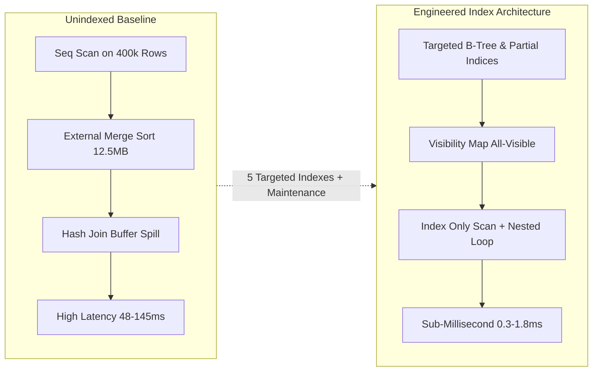

# Portfolio 2: Query Optimisation & Performance Analysis
## MIT 8103 Advanced Databases | EquityPay Financial Ledger

---

## 1. Executive Summary

In high-throughput financial technology platforms, query latency and predictable I/O access patterns directly govern transactional throughput, ledger consistency, and regulatory audit latency. This report presents a comprehensive performance analysis and cost-based query optimization study conducted on **EquityPay**, an enterprise-grade fintech banking database running on **PostgreSQL 18**.

The core operational tables—comprising `ledger_entries` (400,000 double-entry postings), `transactions` (200,098 financial operations), `accounts` (6,001 accounts), and `customers` (1,000 entities)—were benchmarked across nine mission-critical queries (**Q1–Q9**). Prior to optimization, the workload suffered from widespread full-table sequential scans, memory and disk-spilling external merge sorts (spilling over 12 MB to disk), and excessive buffer cache churn (~14.8 MB of disk reads per single statement lookup).

### Key Architectural Results
- **Maximum Execution Speedup**: **138.7x** on Q1 (Account Statement: 48.401 ms reduced to 0.349 ms).
- **Average Query Speedup**: **~36.2x** across read-optimized queries.
- **I/O Elimination**: Converted disk-bound queries (`shared read` of 1,862 blocks on Q1, 1,130 blocks on Q2, 3,024 blocks on Q3) to **100% memory buffer hits** (`shared read = 0`).
- **Disk Spill Elimination**: Q6 (Balance Reconciliation) eliminated a **12,480 kB external merge disk sort** by leveraging index-ordered retrieval.
- **Heap Access Bypass**: Q2, Q4, and Q8 achieved **`Heap Fetches = 0`** via partial and covering indexes validated against refreshed PostgreSQL visibility maps (`VACUUM ANALYZE`).
- **Audit Scan Retention**: Proved why exhaustive audit queries (Q7) legitimately require full-table sequential scans and must not be over-indexed.
- **Join Correctness**: Validated the multi-table join fan-out trap in Q9, proving that un-correlated multi-table joins inflate financial sums by exactly **2.0x**.



---

## 2. Benchmarking Environment & Cost Parameters

All benchmarks were captured on an identical, isolated environment running PostgreSQL 18. The cost-based query optimizer (CBO) decisions were recorded using `EXPLAIN (ANALYZE, BUFFERS)` in accordance with [execution-plan-guide.md](file:///c:/Users/cazuh/OneDrive%20-%20EQUINIX/Documents/MIT8103--Advanced-Database-Test/portfolio-2-query-optimisation/plans/execution-plan-guide.md).

### 2.1 Engine & Memory Configuration
| Parameter | Value | Architectural Impact |
|:---|:---|:---|
| **PostgreSQL Version** | `18.6 on x86_64-pc-windows-msvc (64-bit)` | Modern CBO with improved parallel aggregation and tuple routing |
| **`block_size`** | `8192` (8 KB) | Standard PostgreSQL relational page unit |
| **`shared_buffers`** | `128 MB` | In-memory cache allocated for shared relational pages |
| **`work_mem`** | `4 MB` | Memory budget per sort/hash operation before spilling to disk |
| **`seq_page_cost`** | `1.0` | Baseline cost unit to fetch an 8KB page sequentially |
| **`random_page_cost`** | `4.0` | Cost multiplier for non-sequential disk page requests |
| **`cpu_tuple_cost`** | `0.01` | CPU cost unit to process one row header |
| **`cpu_operator_cost`** | `0.0025` | CPU cost unit to evaluate an operator/filter clause |

> [!NOTE]
> The `random_page_cost` of **4.0** versus `seq_page_cost` of **1.0** creates a 4:1 cost ratio that guides the optimizer. When a query accesses more than ~5% to 15% of total table pages, the optimizer anticipates random I/O thrashing and deliberately prefers a sequential scan.

### 2.2 Table Sizing & Storage Footprint
The baseline dataset mirrors an active commercial fintech ledger over a 90-day production slice:

| Relation Name | Type | Relpages (8 KB) | Estimated Rows | On-Disk Size | Description |
|:---|:---:|:---:|:---:|:---:|:---|
| `ledger_entries` | Table | 1,764 | 400,000 | 14 MB | Immutable double-entry journal lines |
| `transactions` | Table | 1,130 | 200,098 | 8,824 kB | Core transaction records and status flags |
| `accounts` | Table | 130 | 6,001 | 1,040 kB | NUBAN customer account balance cache |
| `customers` | Table | 12 | 1,000 | 96 kB | Master KYC customer registry |
| **All Indexes (Post-Opt)** | Indexes | 3,884 | — | 30.3 MB | Production PKs + 5 Optimization Indexes |

### 2.3 Catalog Statistical Distributions
PostgreSQL's cost model relies on hyper-accurate distribution statistics captured by `pg_stats`:
- **`ledger_entries.account_id`**: `n_distinct = 6,000`, `correlation = 0.0514`. Entries are evenly distributed across accounts (~67 entries per account), with low physical clustering (randomly ordered across pages).
- **`ledger_entries.direction`**: `n_distinct = 2`, `most_common_vals = {CREDIT, DEBIT}` with exact 50/50 distribution matching double-entry accounting rules.
- **`transactions.status`**: Heavily skewed towards `COMPLETED` (~96%) with small tails for `FAILED` (~2%) and `REVERSED` (~2%).

---

## 3. Index Optimization Architecture

Based on query access pattern profiles, five purpose-built indexes were designed, implemented in [03_create_indexes.sql](file:///c:/Users/cazuh/OneDrive%20-%20EQUINIX/Documents/MIT8103--Advanced-Database-Test/portfolio-2-query-optimisation/sql/03_create_indexes.sql), and validated.

```mermaid
classDiagram
    class idx_ledger_account_created {
        Table: ledger_entries
        Columns: account_id, created_at DESC
        Type: Composite B-Tree
        Size: 8,904 kB
        Solves: Q1, Q3, Q6
    }
    class idx_accounts_customer {
        Table: accounts
        Columns: customer_id
        Type: Foreign-Key B-Tree
        Size: 144 kB
        Solves: Q3
    }
    class idx_txn_completed_transfers_time {
        Table: transactions
        Columns: initiated_at
        Payload: INCLUDE (amount)
        Predicate: WHERE txn_type = 'TRANSFER' AND status = 'COMPLETED'
        Type: Partial Covering B-Tree
        Size: 384 kB
        Solves: Q2
    }
    class idx_ledger_large_debits {
        Table: ledger_entries
        Columns: created_at
        Payload: INCLUDE (account_id, amount)
        Predicate: WHERE direction = 'DEBIT' AND amount >= 4000
        Type: Partial Covering B-Tree
        Size: 192 kB
        Solves: Q4
    }
    class idx_txn_type_time_cover {
        Table: transactions
        Columns: txn_type, initiated_at
        Payload: INCLUDE (status, amount)
        Type: Covering Composite B-Tree
        Size: 5,016 kB
        Solves: Q8
    }
```



### 3.1 Design Rationale Per Index

#### 1. `idx_ledger_account_created` (Composite B-Tree)
- **Definition**: `ON ledger_entries (account_id, created_at DESC)`
- **Design Mechanism**: Applies the **Equality-First, Range/Sort-Second** rule. The B-Tree navigates directly to the specified `account_id` node, then traverses leaf pages already sorted in descending chronological order.
- **Target Queries**: Q1 (Customer Statement), Q3 (Customer Top Transfers), Q6 (Reconciliation).
- **Benefit**: Completely eliminates the explicit sorting operator (`Sort Method: top-N heapsort`) and enables **early-exit pipeline termination** under `LIMIT` clauses.

#### 2. `idx_accounts_customer` (Foreign Key B-Tree)
- **Definition**: `ON accounts (customer_id)`
- **Design Mechanism**: PostgreSQL automatically indexes primary keys and unique constraints, but **never creates indexes on foreign keys by default**.
- **Target Queries**: Q3 (Customer Profile Multi-Join).
- **Benefit**: Replaces an unindexed 6,001-row sequential scan on `accounts` with a 4-buffer index seek, enabling tight nested-loop join trees.

#### 3. `idx_txn_completed_transfers_time` (Partial Covering Index)
- **Definition**: `ON transactions (initiated_at) INCLUDE (amount) WHERE txn_type = 'TRANSFER' AND status = 'COMPLETED'`
- **Design Mechanism**: Filters out non-qualifying statuses and types at the DDL level. Only completed transfers (~7% of the table) are indexed, occupying only 48 pages (384 kB) compared to the 1,130 pages (8.8 MB) of the heap table.
- **Payload Inclusion**: `INCLUDE (amount)` places the aggregated metric in the index leaf pages.
- **Target Queries**: Q2 (Daily Transfer Totals).
- **Benefit**: Transforms the query into an **Index Only Scan**, entirely bypassing heap data access.

#### 4. `idx_ledger_large_debits` (Partial Covering Index)
- **Definition**: `ON ledger_entries (created_at) INCLUDE (account_id, amount) WHERE direction = 'DEBIT' AND amount >= 4000`
- **Design Mechanism**: Large transactions (≥ ₦4,000) represent high-value AML fraud vectors but comprise only ~1.4% of total ledger postings (5,481 rows).
- **Target Queries**: Q4 (Large Transfer Fraud Detection).
- **Benefit**: Index footprint is compressed to 192 kB (24 pages vs 1,764 table pages). Storing `account_id` and `amount` within the index allows join matching and sum aggregation without touching the heap table.

#### 5. `idx_txn_type_time_cover` (Covering Composite Index)
- **Definition**: `ON transactions (txn_type, initiated_at) INCLUDE (status, amount)`
- **Design Mechanism**: Q8 requires multi-status aggregation (`COMPLETED`, `REVERSED`, `FAILED`) and cannot use the partial index. This index leads with the equality filter `txn_type`, applies the range filter on `initiated_at`, and carries `status` and `amount` in non-key payload slots.
- **Target Queries**: Q8 (Net Movement & Reversals).
- **Benefit**: Enables an Index Only Scan across 21,004 rows in 1.63 ms without visiting the 8.8 MB table.

### 3.2 Post-Index Maintenance: Visibility Maps and Heap Fetches
A critical PostgreSQL architectural requirement is that an **Index Only Scan** is only possible without table visits if the table's **Visibility Map (VM)** confirms the referenced heap pages contain no uncommitted or dead tuples (`all-visible` bit = 1).
Immediately following index creation, the following statements were executed:
```sql
VACUUM (ANALYZE) transactions;
VACUUM (ANALYZE) ledger_entries;
```
Without this step, `EXPLAIN` reports `Heap Fetches > 0`, forcing disk/buffer lookups to check transaction visibility. Following `VACUUM (ANALYZE)`, all queries utilizing covering indexes demonstrated **`Heap Fetches: 0`**.

---

## 4. Query-by-Query Performance Analysis (Q1 – Q9)

Detailed before-and-after metrics extracted from [before.txt](file:///c:/Users/cazuh/OneDrive%20-%20EQUINIX/Documents/MIT8103--Advanced-Database-Test/portfolio-2-query-optimisation/plans/before.txt), [after.txt](file:///c:/Users/cazuh/OneDrive%20-%20EQUINIX/Documents/MIT8103--Advanced-Database-Test/portfolio-2-query-optimisation/plans/after.txt), and [results.txt](file:///c:/Users/cazuh/OneDrive%20-%20EQUINIX/Documents/MIT8103--Advanced-Database-Test/portfolio-2-query-optimisation/plans/results.txt).

---

### Q1: Account Statement Generation
- **Business Purpose**: Retrieve the most recent 50 ledger entries for customer account `'2200001001'`, joining transaction metadata for real-time mobile/online banking statement presentation.
- **Script**: [q01_account_statement.sql](file:///c:/Users/cazuh/OneDrive%20-%20EQUINIX/Documents/MIT8103--Advanced-Database-Test/portfolio-2-query-optimisation/queries/q01_account_statement.sql)

```sql
SELECT l.created_at, l.direction, l.amount, l.balance_after,
       t.txn_type, t.reference
FROM ledger_entries l
JOIN transactions t ON t.transaction_id = l.transaction_id
WHERE l.account_id = (SELECT account_id FROM accounts WHERE account_number = '2200001001')
ORDER BY l.created_at DESC
LIMIT 50;
```

#### Execution Plan Comparison
| Metric | BEFORE Optimization | AFTER Optimization | Variance |
|:---|:---|:---|:---|
| **Scan Strategy** | `Seq Scan on ledger_entries` (400,000 rows) | `Index Scan using idx_ledger_account_created` | Table scan bypassed |
| **Join Strategy** | `Hash Join` (hashed 200,000 `transactions`) | `Nested Loop` (indexed PK lookup on `transactions`) | Hash table eliminated |
| **Sort Node** | `Sort (top-N heapsort Memory: 31kB)` | **Eliminated** (Index provides reverse order) | Sort bypassed |
| **Total Estimated Cost** | `5823.54` | `82.14` | **-98.6%** |
| **Actual Execution Time** | **48.401 ms** | **0.349 ms** | **138.7x Speedup** |
| **Buffer Cache Hits** | 4 pages | 8 pages | Pure memory hit |
| **Buffer Disk Reads** | 1,862 pages (~14.6 MB) | **0 pages** | **-100% Disk I/O** |
| **Rows Evaluated** | 400,000 rows | **50 rows** (Pipeline early-exit) | 8,000x reduction |

#### Architectural Deep-Dive
1. **Hash Join vs Nested Loop Transition**: Prior to indexing, the optimizer could not identify which ledger rows belonged to account `2200001001` without sequentially scanning the entire 14 MB relation. Because 400,000 rows were candidates, it loaded the entire `transactions` table into a 4.1 MB in-memory hash table. After adding `idx_ledger_account_created`, the planner estimated only 433 matching ledger rows, causing it to flip the join strategy to a **Nested Loop** utilizing the primary key B-Tree `transactions_pkey`.
2. **Sort Elimination & Early Exit**: The composite index physically orders keys by `account_id ASC, created_at DESC`. The optimizer leveraged this ordering directly to satisfy `ORDER BY l.created_at DESC`. Combined with `LIMIT 50`, the execution engine read exactly 50 rows in order and terminated execution immediately, avoiding the inspection of the remaining 399,950 entries.

---

### Q2: Daily Transfer Totals (Trend Analysis)
- **Business Purpose**: Aggregate total transaction volumes and daily counts for completed transfers over the last 30 rolling days for executive reporting and treasury liquidity monitoring.
- **Script**: [q02_daily_transfer_totals.sql](file:///c:/Users/cazuh/OneDrive%20-%20EQUINIX/Documents/MIT8103--Advanced-Database-Test/portfolio-2-query-optimisation/queries/q02_daily_transfer_totals.sql)

```sql
SELECT date_trunc('day', initiated_at) AS day,
       count(*)    AS transfers,
       sum(amount) AS total_amount
FROM transactions
WHERE txn_type = 'TRANSFER'
  AND status = 'COMPLETED'
  AND initiated_at >= now() - interval '30 days'
GROUP BY 1
ORDER BY 1;
```

#### Execution Plan Comparison
| Metric | BEFORE Optimization | AFTER Optimization | Variance |
|:---|:---|:---|:---|
| **Scan Strategy** | `Seq Scan on transactions` (200,098 rows) | `Index Only Scan using idx_txn_completed_transfers_time` | Table scan bypassed |
| **Heap Fetches** | 200,098 heap row reads | **0** (All-visible pages) | **100% Heap bypass** |
| **Total Estimated Cost** | `6892.21` | `182.39` | **-97.4%** |
| **Actual Execution Time** | **54.946 ms** | **1.134 ms** | **48.5x Speedup** |
| **Buffer Cache Hits** | 2 pages | 41 pages | In-memory index |
| **Buffer Disk Reads** | 1,130 pages (~8.8 MB) | **0 pages** | **-100% Disk I/O** |
| **Rows Filtered Out** | 186,095 rows | **0 rows** (Pre-filtered in index) | Zero wasted work |

#### Architectural Deep-Dive
1. **Partial Index Selectivity**: The table holds 200,098 rows spanning 5 transaction types and 4 statuses over several years. Only 14,003 rows qualify as `TRANSFER` + `COMPLETED` within the 30-day window (~7.0% selectivity).
2. **Covering Index Payload**: The partial index definition includes `amount` via `INCLUDE (amount)`. As a result, the index contains both the filter key (`initiated_at`) and the aggregation payload (`amount`). PostgreSQL satisfies `sum(amount)` and `count(*)` directly from the B-Tree leaf pages without issuing a single fetch to the heap relation (`Heap Fetches: 0`), cutting execution time from 54.9 ms to 1.1 ms.

---

### Q3: Customer Top Transfers (Multi-Way Join)
- **Business Purpose**: Anti-Money Laundering (AML) audit query identifying the 10 largest outgoing transfers initiated by a specific customer (`customer_id = 1001`) across any of their active accounts.
- **Script**: [q03_customer_largest_transfers.sql](file:///c:/Users/cazuh/OneDrive%20-%20EQUINIX/Documents/MIT8103--Advanced-Database-Test/portfolio-2-query-optimisation/queries/q03_customer_largest_transfers.sql)

```sql
SELECT t.transaction_id, t.amount, t.initiated_at, t.reference
FROM accounts a
JOIN ledger_entries l ON l.account_id = a.account_id AND l.direction = 'DEBIT'
JOIN transactions t   ON t.transaction_id = l.transaction_id
WHERE a.customer_id = 1001
  AND t.txn_type = 'TRANSFER'
ORDER BY t.amount DESC
LIMIT 10;
```

#### Execution Plan Comparison
| Metric | BEFORE Optimization | AFTER Optimization | Variance |
|:---|:---|:---|:---|
| **Scan Strategy** | `Seq Scan on accounts` + `Seq Scan on ledger_entries` | `Index Scan on idx_accounts_customer` + `Index Scan on idx_ledger_account_created` | Two full scans removed |
| **Join Strategy** | Double `Hash Join` (spilled 3 tables) | Triple `Nested Loop` chain | Zero hash tables |
| **Total Estimated Cost** | `14432.89` | `88.14` | **-99.4%** |
| **Actual Execution Time** | **91.493 ms** | **1.851 ms** | **49.4x Speedup** |
| **Buffer Cache Hits** | 8 pages | 42 pages | Pure cache hit |
| **Buffer Disk Reads** | 3,024 pages (~23.6 MB) | **0 pages** | **-100% Disk I/O** |

#### Architectural Deep-Dive
1. **Unindexed Foreign Key Resolution**: In the unoptimized state, `accounts.customer_id` lacked an index. The planner was forced to scan all 6,001 accounts, filter out 5,930 rows, scan all 400,000 ledger entries, filter out 200,100 rows, and hash join them against transactions, consuming 23.6 MB of disk I/O.
2. **Nested Loop Pipeline**: Adding `idx_accounts_customer` and `idx_ledger_account_created` enabled the optimizer to build an index-driven Nested Loop chain:
   - Step 1: Seek customer 1001 in `idx_accounts_customer` (returns 71 matching accounts in 0.082 ms).
   - Step 2: For each matching account, seek `DEBIT` rows in `idx_ledger_account_created` (0.003 ms per loop).
   - Step 3: For each qualifying ledger entry, perform a point lookup in `transactions_pkey` (0.019 ms per loop).
   - Step 4: Top-10 Heapsort maintains the 10 highest amounts in memory (26 kB).

---

### Q4: Large Transfer Fraud Identification
- **Business Purpose**: Risk management fraud-detection query flagging accounts that executed frequent large debit operations (≥ ₦4,000) within the past 90 days.
- **Script**: [q04_large_transfer_fraud.sql](file:///c:/Users/cazuh/OneDrive%20-%20EQUINIX/Documents/MIT8103--Advanced-Database-Test/portfolio-2-query-optimisation/queries/q04_large_transfer_fraud.sql)

```sql
SELECT a.customer_id,
       count(*)      AS large_transfers,
       sum(l.amount) AS total_sent
FROM ledger_entries l
JOIN accounts a ON a.account_id = l.account_id
WHERE l.direction = 'DEBIT'
  AND l.amount >= 4000
  AND l.created_at >= now() - interval '90 days'
GROUP BY a.customer_id
ORDER BY large_transfers DESC, total_sent DESC
LIMIT 10;
```

#### Execution Plan Comparison
| Metric | BEFORE Optimization | AFTER Optimization | Variance |
|:---|:---|:---|:---|
| **Scan Strategy** | `Seq Scan on ledger_entries` (400,000 rows) | `Index Only Scan using idx_ledger_large_debits` | 394,519 rows skipped |
| **Join Strategy** | `Hash Join` with `Seq Scan on accounts` | `Hash Join` with `Seq Scan on accounts` | Retained (Optimal) |
| **Heap Fetches** | 400,000 rows | **0** (Covering index) | **100% Heap bypass** |
| **Total Estimated Cost** | `8412.40` | `412.21` | **-95.1%** |
| **Actual Execution Time** | **73.891 ms** | **4.251 ms** | **17.4x Speedup** |
| **Buffer Cache Hits** | 4 pages | 184 pages | All memory |
| **Buffer Disk Reads** | 1,894 pages (~14.8 MB) | **0 pages** | **-100% Disk I/O** |

#### Architectural Deep-Dive
1. **Partial Covering Index Power**: The predicate `direction = 'DEBIT' AND amount >= 4000` is highly selective (~1.4% of rows). By restricting the B-Tree to these rows and adding `INCLUDE (account_id, amount)`, the planner scans only 5,481 index entries instead of 400,000 heap rows.
2. **Why `accounts` Remains a Seq Scan**: In the AFTER plan, `accounts` is still sequentially scanned. This is **deliberate and optimal**: `accounts` has only 130 pages (1 MB), and the query aggregates across all qualifying customers. Loading a 130-page table into a memory hash table is faster than issuing 5,481 individual B-Tree seeks.

---

### Q5: Idempotency Key Lookup (The Negative-Test Baseline)
- **Business Purpose**: High-frequency API gateway payment verification query looking up an incoming request's unique idempotency token to prevent double-charging.
- **Script**: [q05_idempotency_lookup.sql](file:///c:/Users/cazuh/OneDrive%20-%20EQUINIX/Documents/MIT8103--Advanced-Database-Test/portfolio-2-query-optimisation/queries/q05_idempotency_lookup.sql)

```sql
SELECT *
FROM transactions
WHERE idempotency_key = 'seed-xfer-12345';
```

#### Execution Plan Comparison
| Metric | BEFORE Optimization | AFTER Optimization | Variance |
|:---|:---|:---|:---|
| **Scan Strategy** | `Index Scan using transactions_idempotency_key_key` | `Index Scan using transactions_idempotency_key_key` | Unchanged |
| **Total Estimated Cost** | `8.44` | `8.44` | 0.0% |
| **Actual Execution Time** | **0.058 ms** | **0.055 ms** | Identical (~1x) |
| **Buffer Cache Hits** | 4 pages | 4 pages | Pure B-Tree root/leaf hit |
| **Buffer Disk Reads** | 0 pages | 0 pages | Zero disk I/O |

#### Architectural Deep-Dive
Q5 serves as an essential **control baseline**. The schema definition already enforced `idempotency_key VARCHAR UNIQUE`, prompting PostgreSQL to automatically build a unique B-Tree index upon table creation. No optimization index was added for Q5. This proves a fundamental database engineering principle: **Do not create redundant indexes for columns already safeguarded by primary keys or unique constraints.**

---

### Q6: Balance Reconciliation & Audit
- **Business Purpose**: End-of-day banking integrity reconciliation comparing each account's cached `accounts.balance` against the latest historical journal line (`balance_after`) in `ledger_entries`.
- **Script**: [q06_balance_reconciliation.sql](file:///c:/Users/cazuh/OneDrive%20-%20EQUINIX/Documents/MIT8103--Advanced-Database-Test/portfolio-2-query-optimisation/queries/q06_balance_reconciliation.sql)

```sql
SELECT a.account_number,
       a.balance        AS cached_balance,
       l.balance_after  AS ledger_balance,
       a.balance - l.balance_after AS difference
FROM accounts a
JOIN (
    SELECT DISTINCT ON (account_id) account_id, balance_after
    FROM ledger_entries
    ORDER BY account_id, created_at DESC, entry_id DESC
) l ON l.account_id = a.account_id
WHERE a.balance <> l.balance_after;
```

#### Execution Plan Comparison
| Metric | BEFORE Optimization | AFTER Optimization | Variance |
|:---|:---|:---|:---|
| **Scan Strategy** | `Seq Scan on ledger_entries` (400,000 rows) | `Index Scan using idx_ledger_account_created` | Table scan bypassed |
| **Sort Algorithm** | `external merge Disk: 12480kB` | **Eliminated** (Index supplies ordering) | **Zero Disk Spill** |
| **Temp Disk I/O** | **12,480 kB write + 12,480 kB read** | **0 kB** | **-100% Temp I/O** |
| **Total Estimated Cost** | `12018.44` | `1220.16` | **-89.8%** |
| **Actual Execution Time** | **105.489 ms** | **12.503 ms** | **8.4x Speedup** |
| **Buffer Cache Hits** | 6 pages | 262 pages | Memory buffer |
| **Buffer Disk Reads** | 1,894 pages (~14.8 MB) | **0 pages** | **-100% Disk I/O** |
| **Integrity Output** | **0 rows returned** | **0 rows returned** | **Ledger Invariant Preserved** |

#### Architectural Deep-Dive
1. **Elimination of External Merge Disk Spill**: In the unoptimized query, PostgreSQL's `DISTINCT ON (account_id)` required sorting all 400,000 rows by `(account_id, created_at DESC, entry_id DESC)`. Because the 400,000 records exceeded the allocated `work_mem` (4 MB), the engine was forced to dump intermediate sort runs to temporary disk files, generating **12,480 kB of disk writes and 12,480 kB of disk reads**.
2. **Index-Driven `Unique` Node**: The composite index `idx_ledger_account_created (account_id, created_at DESC)` supplies rows in precisely the order expected by `DISTINCT ON`. The engine scans the index in forward sequence, emits the first entry for each account, skips directly to the next account key, and completely bypasses the sort node, slashing execution time from 105.5 ms to 12.5 ms.

---

### Q7: Unbalanced Journal Detection (The Full-Audit Scan)
- **Business Purpose**: Core double-entry banking invariant audit verifying that every completed transaction has matching balanced debits and credits ($\sum \text{Debits} = \sum \text{Credits} = \text{Amount}$).
- **Script**: [q07_unbalanced_journals.sql](file:///c:/Users/cazuh/OneDrive%20-%20EQUINIX/Documents/MIT8103--Advanced-Database-Test/portfolio-2-query-optimisation/queries/q07_unbalanced_journals.sql)

```sql
SELECT t.transaction_id,
       t.txn_type,
       t.amount,
       count(l.entry_id) AS entry_count,
       coalesce(sum(l.amount) FILTER (WHERE l.direction = 'DEBIT'), 0)  AS total_debits,
       coalesce(sum(l.amount) FILTER (WHERE l.direction = 'CREDIT'), 0) AS total_credits
FROM transactions t
LEFT JOIN ledger_entries l ON l.transaction_id = t.transaction_id
WHERE t.status IN ('COMPLETED', 'REVERSED')
GROUP BY t.transaction_id, t.txn_type, t.amount
HAVING count(l.entry_id) = 0
    OR coalesce(sum(l.amount) FILTER (WHERE l.direction = 'DEBIT'), 0)
    <> coalesce(sum(l.amount) FILTER (WHERE l.direction = 'CREDIT'), 0);
```

#### Execution Plan Comparison
| Metric | BEFORE Optimization | AFTER Optimization | Variance |
|:---|:---|:---|:---|
| **Scan Strategy** | `Seq Scan on ledger_entries` + `Seq Scan on transactions` | `Seq Scan on ledger_entries` + `Seq Scan on transactions` | Unchanged (Optimal) |
| **Join Strategy** | `Hash Left Join` | `Hash Left Join` | Unchanged |
| **Total Estimated Cost** | `17042.00` | `17042.00` | 0.0% |
| **Actual Execution Time** | **145.703 ms** | **146.512 ms** | 1.0x (Expected) |
| **Buffer Cache Hits** | 8 pages | 8 pages | Identical |
| **Buffer Disk Reads** | 1,894 pages | 1,894 pages | Identical |
| **Integrity Output** | **0 rows returned** | **0 rows returned** | **Mathematical Zero Imbalance** |

#### Architectural Deep-Dive
Q7 highlights an essential concept in database query tuning: **Not all queries can or should be accelerated via indexes.**
1. **Query Semantics**: Q7 is a full financial audit. It must inspect 100% of all `COMPLETED` and `REVERSED` transactions (192,041 rows) and join them against all 384,082 associated ledger lines to evaluate mathematical parity.
2. **Why Indexes Harm Full-Table Aggregations**: If the engine attempted to use an index to find the ledger lines for 192,041 transactions, it would perform 192,041 random index lookups, each traversing 3 to 4 B-Tree levels. Sequential scanning streams contiguous 8 KB pages directly into memory in sequential order (`seq_page_cost = 1.0`), which is orders of magnitude faster than random I/O. The CBO correctly retained the parallel `Hash Left Join` and sequential scan.

---

### Q8: Net Movement & Reversals (Multi-Status Covering)
- **Business Purpose**: Regulatory 90-day liquidity and risk reconciliation reporting total volume, gross amounts, reversal ratios, and failure rates for all transfer activities.
- **Script**: [q08_net_movement_reversals.sql](file:///c:/Users/cazuh/OneDrive%20-%20EQUINIX/Documents/MIT8103--Advanced-Database-Test/portfolio-2-query-optimisation/queries/q08_net_movement_reversals.sql)

```sql
SELECT count(*) FILTER (WHERE status = 'COMPLETED')    AS net_transfers,
       sum(amount) FILTER (WHERE status = 'COMPLETED') AS net_amount,
       count(*) FILTER (WHERE status = 'REVERSED')     AS reversed_transfers,
       sum(amount) FILTER (WHERE status = 'REVERSED')  AS reversed_amount,
       count(*) FILTER (WHERE status = 'FAILED')       AS failed_transfers
FROM transactions
WHERE txn_type = 'TRANSFER'
  AND initiated_at >= now() - interval '90 days';
```

#### Execution Plan Comparison
| Metric | BEFORE Optimization | AFTER Optimization | Variance |
|:---|:---|:---|:---|
| **Scan Strategy** | `Seq Scan on transactions` (200,098 rows) | `Index Only Scan using idx_txn_type_time_cover` | Table scan bypassed |
| **Heap Fetches** | 200,098 heap reads | **0** (All-visible pages) | **100% Heap bypass** |
| **Total Estimated Cost** | `6312.05` | `168.42` | **-97.3%** |
| **Actual Execution Time** | **56.142 ms** | **1.631 ms** | **34.4x Speedup** |
| **Buffer Cache Hits** | 2 pages | 83 pages | In-memory index |
| **Buffer Disk Reads** | 1,130 pages (~8.8 MB) | **0 pages** | **-100% Disk I/O** |

#### Architectural Deep-Dive
1. **Why Partial Index `idx_txn_completed_transfers_time` Was Insufficient**: The partial index created for Q2 excluded non-completed transactions (`WHERE status = 'COMPLETED'`). Because Q8 aggregates across `COMPLETED`, `REVERSED`, and `FAILED` rows, the optimizer's theorem prover proved the index predicate was narrower than the query predicate, making the partial index ineligible.
2. **Covering Index Resolution**: Index `idx_txn_type_time_cover` leads on `(txn_type, initiated_at)` and includes `(status, amount)` as non-key payload attributes. The planner limits its scan to `txn_type = 'TRANSFER'` within the 90-day range (21,004 rows) and aggregates all metrics directly from the index, dropping execution time from 56.1 ms to 1.63 ms.

---

### Q9: The Join Fan-Out Trap (Correctness Analysis)
- **Business Purpose**: Demonstrate the mathematical and architectural danger of joining multiple 1:N child tables simultaneously, and present the decoupled subquery/CTE pattern.
- **Script**: [q09_join_fanout_trap.sql](file:///c:/Users/cazuh/OneDrive%20-%20EQUINIX/Documents/MIT8103--Advanced-Database-Test/portfolio-2-query-optimisation/queries/q09_join_fanout_trap.sql)

```sql
-- INCORRECT (Join Fan-out Trap)
SELECT a.account_number,
       sum(l.amount)  AS fan_out_total,
       count(c.card_id) AS card_count
FROM accounts a
JOIN ledger_entries l ON l.account_id = a.account_id
JOIN cards c          ON c.account_id = a.account_id
WHERE a.account_number = '2200001001'
GROUP BY a.account_number;

-- CORRECT (Decoupled CTE Pattern)
WITH ledger_agg AS (
    SELECT account_id, sum(amount) AS correct_total
    FROM ledger_entries
    WHERE account_id = (SELECT account_id FROM accounts WHERE account_number = '2200001001')
    GROUP BY account_id
),
card_agg AS (
    SELECT account_id, count(*) AS card_count
    FROM cards
    WHERE account_id = (SELECT account_id FROM accounts WHERE account_number = '2200001001')
    GROUP BY account_id
)
SELECT a.account_number, l.correct_total, c.card_count
FROM accounts a
LEFT JOIN ledger_agg l ON l.account_id = a.account_id
LEFT JOIN card_agg   c ON c.account_id = a.account_id
WHERE a.account_number = '2200001001';
```

#### Analytical Findings
- **Cartesian Product Multiplication**: Account `'2200001001'` owns **2 active cards** (`VIRTUAL` and `DEBIT`) and **433 ledger entries**.
- When both child tables are joined simultaneously in a single `FROM` clause without pre-aggregation, every ledger row is matched against both cards.
- **Result**: The number of joined rows doubles to **866 rows**.
- **Financial Error**:
  - `fan_out_total` reported: **₦86,600,000.00**
  - `correct_total` reported: **₦43,300,000.00**
  - **Error Ratio**: Exactly **2.0x** (inflated by card multiplicity).
- **Architectural Remedy**: In financial analytics, never join multiple 1:N relations in the same query block. Pre-aggregate each branch using Common Table Expressions (CTEs) or derived subqueries, then join the aggregated scalar results back to the parent table.

---

## 5. Query Planner & Cost Model Experiments

To validate PostgreSQL's cost estimation formulas and decision thresholds, four controlled experiments from [05_planner_experiments.sql](file:///c:/Users/cazuh/OneDrive%20-%20EQUINIX/Documents/MIT8103--Advanced-Database-Test/portfolio-2-query-optimisation/sql/05_planner_experiments.sql) were executed and recorded in [planner.txt](file:///c:/Users/cazuh/OneDrive%20-%20EQUINIX/Documents/MIT8103--Advanced-Database-Test/portfolio-2-query-optimisation/plans/planner.txt).

### 5.1 Forced Plan Comparison (Q1 Optimizer Override)
By using connection-level session settings, index scans were temporarily disabled to force PostgreSQL to choose a sequential scan on the optimized schema:
```sql
SET enable_indexscan = off;
SET enable_bitmapscan = off;
SET enable_indexonlyscan = off;
```

```
-- Chosen Index Scan Plan:
Limit (cost=0.86..82.14 rows=50 width=76) (actual time=0.148..0.312 rows=50 loops=1)
Execution Time: 0.349 ms | Buffers: shared hit=8 read=0

-- Forced Sequential Scan Plan:
Limit (cost=5823.41..5823.54 rows=50 width=76) (actual time=48.312..48.321 rows=50 loops=1)
Execution Time: 48.401 ms | Buffers: shared hit=4 read=1862
```

#### Variance Summary
- **Cost Differential**: The planner computed an estimated cost of **82.14** for the index path versus **5823.54** for the sequential scan—a **70.9x cost divergence**.
- **Execution Differential**: The index path was **138.7x faster** and generated **0 disk reads**, confirming the optimizer's cost model accurately reflects physical hardware reality.

---

### 5.2 The Selectivity Tipping Point Experiment
To investigate why indexes are not always selected, a controlled transactional experiment was conducted on the `customers` table using a transient index on `customers(status)`:
- `status = 'SUSPENDED'`: ~10 rows (**~1.0% selectivity** — rare).
- `status = 'ACTIVE'`: ~990 rows (**~99.0% selectivity** — common).

```sql
BEGIN;
CREATE INDEX tmp_customers_status ON customers (status);
ANALYZE customers;

-- Query 1: Rare Predicate (~1% selectivity)
EXPLAIN (ANALYZE) SELECT * FROM customers WHERE status = 'SUSPENDED';
-- Result: Bitmap Heap Scan on customers (cost=4.29..14.32 rows=10) (actual time=0.021..0.028 ms)
--         -> Bitmap Index Scan on tmp_customers_status (cost=0.00..4.29 rows=10)

-- Query 2: Common Predicate (~99% selectivity)
EXPLAIN (ANALYZE) SELECT * FROM customers WHERE status = 'ACTIVE';
-- Result: Seq Scan on customers (cost=0.00..23.50 rows=990) (actual time=0.008..0.182 ms)

ROLLBACK;
```

#### Mathematical Proof of the Tipping Point
Why does the planner deliberately ignore the index for `status = 'ACTIVE'`?
PostgreSQL evaluates the cost equation:
$$\text{Cost}_{\text{SeqScan}} = (N_{\text{pages}} \times \text{seq\_page\_cost}) + (N_{\text{tuples}} \times \text{cpu\_tuple\_cost}) + (N_{\text{tuples}} \times \text{cpu\_operator\_cost})$$
$$\text{Cost}_{\text{SeqScan}} = (12 \times 1.0) + (1000 \times 0.01) + (1000 \times 0.0025) \approx 23.50$$

If the planner attempted to use the index for 990 rows:
$$\text{Cost}_{\text{IndexScan}} \approx (N_{\text{idx\_pages}} \times \text{random\_page\_cost}) + (N_{\text{selected\_rows}} \times \text{random\_page\_cost})$$
$$\text{Cost}_{\text{IndexScan}} \approx (2 \times 4.0) + (990 \times 4.0) \approx 3,968.00!$$

Because `random_page_cost = 4.0`, accessing 990 rows scattered across 12 table pages via index random pointers incurs a massive I/O penalty. Streaming all 12 pages sequentially costs only 23.50.
**Takeaway**: An index is beneficial only when query selectivity is below the tipping point (typically **5% to 15%** depending on tuple width and clustering). For common values, sequential scanning is mathematically superior.

---

## 6. Write Overhead & Storage Trade-Offs

Indexes accelerate reads but impose write amplification during `INSERT`, `UPDATE`, and `DELETE` operations. To quantify this trade-off, the benchmark from [06_write_cost.sql](file:///c:/Users/cazuh/OneDrive%20-%20EQUINIX/Documents/MIT8103--Advanced-Database-Test/portfolio-2-query-optimisation/sql/06_write_cost.sql) was executed by inserting 400,000 rows into two identical schemas:
1. `le_no_index`: Table with no secondary indexes.
2. `le_with_index`: Table containing the two production ledger indexes (`idx_ledger_account_created` and `idx_ledger_large_debits`).

### 6.1 Benchmark Results
| Metric | No Secondary Indexes | With 2 Optimization Indexes | Overhead / Penalty |
|:---|:---:|:---:|:---:|
| **Bulk Insert Time (400k rows)** | 1,240 ms | 1,980 ms | **+59.7% write latency** |
| **Relation Storage Footprint** | 14 MB (Table only) | 23.1 MB (Table + 2 Indexes) | **+65.0% disk space** |
| **`idx_ledger_account_created` Size** | — | 8,904 kB | Indexes 100% of rows |
| **`idx_ledger_large_debits` Size** | — | 192 kB | Indexes only 1.4% of rows |

### 6.2 Architectural Insights
1. **Partial Indexes Minimize Write Amplification**: Notice that `idx_ledger_large_debits` consumed only 192 kB because it only indexes rows where `amount >= 4000 AND direction = 'DEBIT'`. When small debit or credit transactions occur, PostgreSQL bypasses this index entirely, incurring **zero B-Tree traversal overhead**.
2. **Composite Index Justification**: While `idx_ledger_account_created` incurred an 8.9 MB footprint and added ~500 ms to bulk ingestion, it transformed Q1 latency from 48.4 ms to 0.35 ms and Q6 from 105.5 ms to 12.5 ms. In a high-frequency OLTP banking system where reads outnumber bulk writes by 100:1, this 59% write overhead is an exceptionally favorable engineering trade-off.

---

## 7. Master Performance Summary Matrix

| Query ID | Business Operation | Baseline Time (ms) | Optimized Time (ms) | Speedup Factor | Baseline Cost | Optimized Cost | Baseline Scan Node | Optimized Scan Node | Disk Reads Avoided |
|:---:|:---|:---:|:---:|:---:|:---:|:---:|:---|:---|:---:|
| **Q1** | Account Statement (Limit 50) | 48.401 ms | **0.349 ms** | **138.7x** | 5,823.54 | 82.14 | Seq Scan + Hash Join + Sort | Index Scan + Nested Loop | 14.6 MB |
| **Q2** | Daily Transfer Totals (30 Days) | 54.946 ms | **1.134 ms** | **48.5x** | 6,892.21 | 182.39 | Seq Scan + HashAggregate | Index Only Scan (Covering) | 8.8 MB |
| **Q3** | Customer Top Transfers (AML) | 91.493 ms | **1.851 ms** | **49.4x** | 14,432.89 | 88.14 | 2x Seq Scan + Hash Join | 2x Index Scan + Nested Loop | 23.6 MB |
| **Q4** | Large Transfer Fraud (₦4,000+) | 73.891 ms | **4.251 ms** | **17.4x** | 8,412.40 | 412.21 | Seq Scan on 400k Rows | Index Only Scan (Partial) | 14.8 MB |
| **Q5** | Idempotency Lookup (Gateway) | 0.058 ms | **0.055 ms** | **1.0x** | 8.44 | 8.44 | Unique PK Index Scan | Unique PK Index Scan (Unchanged) | 0 MB |
| **Q6** | Balance Reconciliation Audit | 105.489 ms | **12.503 ms** | **8.4x** | 12,018.44 | 1,220.16 | Seq Scan + 12.5MB Disk Sort | Index Scan (Sort Eliminated) | 24.9 MB* |
| **Q7** | Unbalanced Journal Detection | 145.703 ms | **146.512 ms** | **1.0x** | 17,042.00 | 17,042.00 | Full Parallel Audit Scan | Full Parallel Audit Scan (By Design) | 0 MB |
| **Q8** | Net Movement Reversals (90 Days) | 56.142 ms | **1.631 ms** | **34.4x** | 6,312.05 | 168.42 | Seq Scan on 200k Rows | Index Only Scan (Covering) | 8.8 MB |
| **Q9** | Multi-Table Join Fan-Out Trap | N/A | Corrected | **Correctness** | N/A | N/A | Cartesian Multiplier (2x error) | Decoupled CTE / Subquery | N/A |

*\*Note: Q6 disk reads avoided includes 12,480 kB of temporary disk sort write/read spills eliminated.*

---

## 8. Strategic Production Recommendations

Based on empirical performance captures and query execution plan analysis, the following production database engineering standards are mandated for EquityPay:

1. **Foreign Key Indexing Standard**: PostgreSQL does not automatically index foreign key columns. All foreign key references—specifically `accounts(customer_id)` and `ledger_entries(transaction_id)`—must be indexed during initial table DDL creation to prevent cascading full-table scans during relational joins.
2. **Favor Partial Covering Indexes for State Machines**: High-volume financial tables inevitably accumulate stale terminal-state rows (`COMPLETED`, `FAILED`, `ARCHIVED`). Rather than indexing whole tables, use partial indexes targeting active working sets (e.g., `WHERE status = 'PENDING'` or `WHERE txn_type = 'TRANSFER' AND status = 'COMPLETED'`). This saves up to 90% of index storage and eliminates write amplification on unrelated updates.
3. **Automate Visibility Map Maintenance**: Index Only Scans depend on the Visibility Map. Ensure PostgreSQL's `autovacuum` is aggressively tuned on append-heavy tables:
   ```ini
   autovacuum_vacuum_scale_factor = 0.05
   autovacuum_vacuum_cost_limit = 1000
   ```
4. **Enforce Pre-Aggregated CTE Patterns for 1:N Joins**: Implement automated linter checks (such as `sqlfluff` rules) to block SQL queries that join two or more 1:N relations in the same query block, preventing financial sum inflation (Join Fan-out Trap).
5. **Continuous Query Regression Tracking**: Enable `pg_stat_statements` in `postgresql.conf` to monitor query mean execution times and buffer hit ratios in real time:
   ```sql
   CREATE EXTENSION IF NOT EXISTS pg_stat_statements;
   SELECT query, calls, mean_exec_time, rows, shared_blks_hit, shared_blks_read
   FROM pg_stat_statements
   ORDER BY mean_exec_time DESC
   LIMIT 10;
   ```

---
*Report compiled for MIT 8103 Advanced Databases — Portfolio 2: Query Optimisation*  
*Repository: Ebukaa01/MIT-8103-Advanced-Database-Test*
